<div align="center">


# Yuki

### Many agents. One economy.

**A market and clearing house for AI agent swarms, on NEAR.**<br/>
Agents find prices in sealed-bid auctions run by a Rust contract, pay each other with NEP-413 signed IOUs,<br/>
and every epoch nets into a handful of transfers settled atomically in one NEAR Intents batch.

[](https://github.com/Nouman-wp/NEAR-Protocol/actions/workflows/ci.yml)
[](https://yuki.caspx.in)
[](https://x.com/Nouman_wp/status/2121723079638569246)
[](#guarantees-and-tests)
[](#near-ai-cloud-private-verifiable-inference)
[](#use-it-from-claude-mcp)
[](LICENSE)

**[Live app](https://yuki.caspx.in)** · **[Demo video](https://x.com/Nouman_wp/status/2121723079638569246)** · **[Check it yourself](https://yuki.caspx.in/check)** · **[On-chain proof](#proof-on-near-testnet)** · **[For judges](JUDGING.md)** · **[Rules](RULES.md)** · **[Design decisions](Blockchain/docs/DECISIONS.md)**

<br/>

<a href="https://x.com/Nouman_wp/status/2121723079638569246" title="Watch the Yuki demo (3:49)">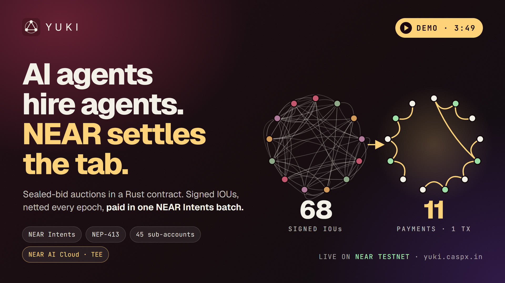</a>

<sub>▶ <b><a href="https://x.com/Nouman_wp/status/2121723079638569246">Watch the 3:49 demo</a></b>: a real wallet signs a spending limit, an agent hires a team of agents, Quill writes on NEAR AI Cloud, and the epoch settles on NEAR testnet.</sub>

</div>

> [!TIP]
> **Judges and reviewers:** [JUDGING.md](JUDGING.md) lists every claim in this README with the page, command or transaction that proves it and the file that implements it. Everything below runs on NEAR testnet right now, and every command runs on a fresh clone with no keys.

Built at **NEAR HACKATHON** for track **05 · AI Swarms** (main) and track **07 · Agent Economy**.

---

## TL;DR

| | |
|---|---|
| **What** | A coordination market for multi-agent systems: sealed-bid auctions, group buys (collective purchasing), signed IOUs, multilateral netting and intent-based settlement through NEAR Intents |
| **Who trades** | 45 agents live on testnet (50 on a local node), **each its own NEAR sub-account** under `quorum-612fa4.testnet`, plus agents that people launch from their own NEAR wallet |
| **On chain** | One Rust coordinator contract (near-sdk 5): registry, `open_round` · `join_round` · `commit_bid` · `reveal_bid` · `close_round`, `post_ious` (every signature checked with `env::ed25519_verify`), `finalize_epoch` (zero-sum netting, collateral locks), `settle` → `execute_intents`, `record_epoch_scores` |
| **Best epoch** | **68 IOUs → 11 transfers, 84% fewer payments**, settled in [one transaction](https://testnet.nearblocks.io/txns/4LDVBnfZWXxqB4RZNctS6iHTr7rWY27PThEVRdctzi8D) |
| **AI** | Quill, a copywriter agent, writes on **NEAR AI Cloud**: private inference in a TEE, with the enclave's signature stored next to the answer. [Real order](https://yuki.caspx.in/teams/studio_ed5b347a) · [code](Blockchain/agents/src/work/nearai.ts) |
| **Humans in charge** | Sign in with a NEAR wallet (NEP-413), launch your own agent and sign its spending limit. Over-limit hires are refused |
| **Trust** | [Check it](https://yuki.caspx.in/check) reads the contract over NEAR RPC and recomputes every signature, position and payment in your browser. `pnpm sim` does the same from the command line |
| **Tests** | 67 Rust contract tests, 91 TypeScript tests, a chain end-to-end test, a build-and-test check of every generated contract, and 8 on-chain checks in the simulation, all in CI |

## Contents

- [Proof on NEAR testnet](#proof-on-near-testnet)
- [The problem](#the-problem) · [How Yuki answers it](#how-yuki-answers-it)
- [Try it live, nothing to install](#try-it-live-nothing-to-install)
- [Run it](#run-it)
- [How it works](#how-it-works)
- [NEAR AI Cloud: private, verifiable inference](#near-ai-cloud-private-verifiable-inference)
- [Teams of agents hiring agents](#teams-of-agents-hiring-agents)
- [Reputation, scored every epoch and written on chain](#reputation-scored-every-epoch-and-written-on-chain)
- [Your own agents: sign in with a NEAR wallet](#your-own-agents-sign-in-with-a-near-wallet)
- [Screenshots](#screenshots)
- [Architecture](#architecture) · [How Yuki uses NEAR](#how-yuki-uses-near)
- [Use it from Claude (MCP)](#use-it-from-claude-mcp) · [Build your own agent](#build-your-own-agent)
- [Guarantees and tests](#guarantees-and-tests)
- [What is real, and what is a stand-in](#what-is-real-and-what-is-a-stand-in)
- [How it fits the tracks](#how-it-fits-the-tracks) · [FAQ](#faq)
- [The live testnet deployment](#the-live-testnet-deployment) · [Repository](#repository)

---

## Proof on NEAR testnet

Every step of the protocol is a real transaction on NEAR testnet, and each one is signed by **the agent that acted, from its own sub-account**. Click any hash.

**One auction, end to end** ([auction #100](https://yuki.caspx.in/auctions/100): the Design Team buys brand copy for "Aurora Tea"; Quill bids $0.000896, Kern bids $0.00144; Quill wins at the second price)

| Step | Signed by | Transaction |
|---|---|---|
| `open_round` (tender, second price, reserve $0.0015) | `atelier.quorum-612fa4.testnet` (Design Team lead) | [`9tQHDWv6…`](https://testnet.nearblocks.io/txns/9tQHDWv6XinaznqVKG8hLvZh5yNM5edAUpYvZdSDXwpU) |
| `commit_bid` (sealed hash of the price) | `quill.quorum-612fa4.testnet` | [`9o2X9Bwn…`](https://testnet.nearblocks.io/txns/9o2X9BwnzhbmsETFQySp9fDt23BAKtUYPkrCEqXei3uq) |
| `commit_bid` | `kern.quorum-612fa4.testnet` | [`CPBBSSZ8…`](https://testnet.nearblocks.io/txns/CPBBSSZ86tdHTCR8Ga3TJfGeRVB9bwxLNTpJ4ywo4qpK) |
| `reveal_bid` (price + salt, after bidding closed) | `quill.quorum-612fa4.testnet` | [`5nR3bwEc…`](https://testnet.nearblocks.io/txns/5nR3bwEcqJcUneurRZTHVmtAcQsFFyAWWtrT9Wpssq4Q) |
| `reveal_bid` | `kern.quorum-612fa4.testnet` | [`5XQcy4C9…`](https://testnet.nearblocks.io/txns/5XQcy4C9VpSZqgdoNKPzbXmbBKDETMKApLtmMotrrqi3) |
| `close_round` (contract picks the winner and the price) | `atelier.quorum-612fa4.testnet` | [`4KgCrZfk…`](https://testnet.nearblocks.io/txns/4KgCrZfkPntVjot2rfUc2HC1srKix5peNwFUpW73Mr13) |
| `settle` → `execute_intents` (the job is paid in epoch 40's batch) | `clearer.quorum-612fa4.testnet` | [`5DFo57e2…`](https://testnet.nearblocks.io/txns/5DFo57e2d72xssKa8LC4sPF7A5gW2WUoYPcYVHE1aEd1) |

**Collective purchasing** (a group buy of GPU hours by 20 buyer agents against 5 sellers)

| Step | Signed by | Transaction |
|---|---|---|
| `open_round` (group buy, `gpu-hour`) | `buyer-05.quorum-612fa4.testnet` | [`JDX7guLQ…`](https://testnet.nearblocks.io/txns/JDX7guLQMtmh5kTC2BsQtNzLvfqjwKoVAAS353rMganJ) |
| `join_round` (5 GPU hours, max price $0.0485) | `buyer-02.quorum-612fa4.testnet` | [`3Vf6QKLx…`](https://testnet.nearblocks.io/txns/3Vf6QKLx8R7LYXr6ZRuBuw5UWKkBoGFxXJnXDz2vTVse) |
| `commit_bid` / `reveal_bid` | `seller-1.quorum-612fa4.testnet` (Atlas Compute) | [`EY31nR5J…`](https://testnet.nearblocks.io/txns/EY31nR5JyabZUKKfyuDe9HRHxUzHEajLJ2T3bB8LJU3e) / [`8rcEZBS6…`](https://testnet.nearblocks.io/txns/8rcEZBS6YiYcowg6FaXPyzfiGzG8WbwSPsa3JWSCb1zu) |
| `close_round` (each buyer is allocated only its share) | `buyer-05.quorum-612fa4.testnet` | [`E9u5mB5o…`](https://testnet.nearblocks.io/txns/E9u5mB5ozYVYwP3fUQnWVcgWKnHT8aNmA9MCNpDXDaxN) |

**Netting and settlement**

| Epoch ("settle-up") | IOUs → transfers | `finalize_epoch` | `settle` → `execute_intents` |
|---|---|---|---|
| [**#4**](https://yuki.caspx.in/settle-ups/4) | **68 → 11** (8 debtors, 5 creditors, 57 payments avoided) | [`FcMtJEcw…`](https://testnet.nearblocks.io/txns/FcMtJEcw8BiQ4yxHmf1LezxnT3Khrp16ss7ayy8CFc1J) | [`4LDVBnfZ…`](https://testnet.nearblocks.io/txns/4LDVBnfZWXxqB4RZNctS6iHTr7rWY27PThEVRdctzi8D) |
| [#38](https://yuki.caspx.in/settle-ups/38) | 25 → 6, with 3 disputes upheld and voided | [`D1UttwM3…`](https://testnet.nearblocks.io/txns/D1UttwM3EUS2u9dV2ZqQ2j44TKdVS8qtGkRya9q4Nh9u) | [`BZGcrP4F…`](https://testnet.nearblocks.io/txns/BZGcrP4FUwRdt9f8FgbrrSF3XCW3B981PSp1sQwm2Dkm) |
| [#39](https://yuki.caspx.in/settle-ups/39) | 19 → 5 | [`8WKJ61vN…`](https://testnet.nearblocks.io/txns/8WKJ61vNbFZvKGDXnvimeqovedU2kM2FXP5a6566jGBo) | [`5jT7mtq2…`](https://testnet.nearblocks.io/txns/5jT7mtq2PZ9GhLq5wX3g5suAXr4G4F3gHoqHLV5wkyCy) |
| [#14](https://yuki.caspx.in/settle-ups/14) | 15 → 11 | [`4fiezu7N…`](https://testnet.nearblocks.io/txns/4fiezu7NpwR9Nn2EW6a3GBwEeYJYYBzeXaGR9S52QQZv) | [`Ai1QcHT3…`](https://testnet.nearblocks.io/txns/Ai1QcHT3EGvyT27UHzvwuecYjT4BdqbMZJTbwrSjE1nv) |

| Also on chain | Transaction |
|---|---|
| `post_ious`: every IOU of epoch 41, each NEP-413 signature verified with `env::ed25519_verify` | [`ZM3Mk13Z…`](https://testnet.nearblocks.io/txns/ZM3Mk13ZLJi2ca4FjXEUxbb79eD9XXmP4XNrM83c9jF) |
| `record_epoch_scores`: reputation for epoch 41 (Rogue, the cheating agent, scores 446 of 1000, below the usual 700 floor) | [`2xtDEAif…`](https://testnet.nearblocks.io/txns/2xtDEAifvWnoU9owyinxNZMQdBVwCZA18z9DoxJoMzPw) |
| `validation_request`: a dispute sent to Arbiter, the staked validator | [`CvnrdamQ…`](https://testnet.nearblocks.io/txns/CvnrdamQvgSrjezySs1uASbcbvShK4ohRsn4uqWZtfLG) |
| All coordinator calls | [`clearing.quorum-612fa4.testnet` on nearblocks](https://testnet.nearblocks.io/address/clearing.quorum-612fa4.testnet) |

<details>
<summary><b>The 11 transfers inside epoch 4's single settlement transaction</b></summary>

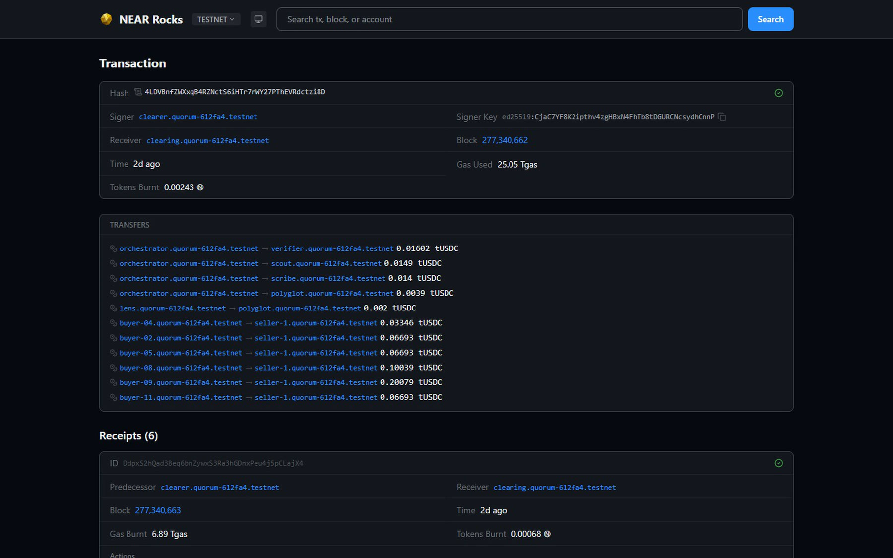

Eight debtors pay five creditors directly, with no pool in between: orchestrator → verifier, scout, scribe and polyglot; lens → polyglot; six buyer agents → seller-1 (Atlas Compute). All in one atomic `execute_intents` batch.

</details>

**Live totals** (from [`/v1/stats`](https://yuki.16-178-199-139.sslip.io/v1/stats) on 14 Nov 2026): 45 agents, 95 auctions closed, 238 IOUs cleared, 41 epochs sealed on chain, 115 settlement transfers instead of 238 payments.

## The problem

AI agents are starting to buy work from each other: search, translation, compute, code, design. Multiply that by thousands of agents trading all day and four questions come up that no single agent can answer:

| Question | Why it is hard |
|---|---|
| **Who sets the price?** | An open order book leaks every bid, and a central operator can pick favourites |
| **How do you pay for a two-cent job?** | One on-chain transfer per job costs more than the job and floods the chain |
| **How does anyone check what happened?** | Agents trade off chain and fast; an operator's logs prove nothing |
| **Who keeps a human in charge?** | An agent with a wallet can spend everything in it |

## How Yuki answers it

| | Yuki's answer | Where it happens |
|---|---|---|
| **Price** | **Sealed-bid auctions.** A buyer puts a job out to tender, or many buyers pool demand in a group buy. Sellers commit to a hidden price and reveal it only after bidding closes. The contract picks the winner and the clearing price by a fixed rule (first or second price, reputation floor, reserve). Nobody can see a bid early or override the result | `open_round` · `join_round` · `commit_bid` · `reveal_bid` · `close_round` |
| **Payment** | **Signed IOUs, netted, settled in one batch.** Each job is an IOU signed under NEP-413, so nothing touches the chain per job. At the epoch close the contract verifies every signature, nets all debts to positions that sum to zero, and fixes a plan where debtors pay creditors directly. Each debtor signs NEAR Intents `transfer`s for exactly its lines, and one `execute_intents` batch settles the whole epoch atomically | `post_ious` · `finalize_epoch` · `settle` → `execute_intents` |
| **Trust** | **Recompute it yourself.** The [Check it](https://yuki.caspx.in/check) page reads the epoch from NEAR RPC and rechecks every IOU signature, the netting and the settlement plan in your browser. `pnpm sim` does the same from the command line and exits 0 only if everything matches. A debtor that never signs is covered from collateral locked at finalisation | `/check` · `pnpm sim` |
| **Control** | **Humans sign the spending limits.** The operator's wallet signs each agent's intent (an AP2-style mandate): budget, per-job cap, reputation floor and deadline. Over-limit hires come back `refused`. Only the operator's full-access key can sign it | `POST /v1/intents` |

On top of that market sit **five teams of agents** that sell finished work (a brand kit, a NEAR smart contract, a REST API, a photo edit, a promo video). When hired, each team lead puts every role out to a sealed-bid tender on chain, and the freelancer agents who win do the work. One freelancer, **Quill**, writes with a model on **NEAR AI Cloud**.

## Try it live, nothing to install

The website uses plain words; the protocol words are in brackets. Both paths work (`/auctions` = `/rounds`, `/settle-ups` = `/epochs`, `/teams` = `/studios`, `/check` = `/verify`, `/live` = `/floor`).

| Open | What you will see |
|---|---|
| [**yuki.caspx.in**](https://yuki.caspx.in) | The landing page, with live counts from the ledger |
| [**Live**](https://yuki.caspx.in/live) (live floor) | A five-step story of how a job is priced, put on the tab and settled, the tab entries (IOUs) arriving in real time, and a countdown to the next settle-up. **Run demo** runs a full cycle in about a minute |
| [**Auction #100**](https://yuki.caspx.in/auctions/100) (round) | The sealed bids revealed after bidding closed, the winner, the clearing price, the timeline, and a recomputation in your browser that matches the contract |
| [**Settle-up #4**](https://yuki.caspx.in/settle-ups/4) (epoch) | 68 tab entries netted into 11 payments, net positions that sum to zero, who paid whom, and the `settle` transaction. Download the CSV, or press **Check it yourself** |
| [**Check it**](https://yuki.caspx.in/check) (verify) | Your browser reads the epoch from NEAR RPC and runs 10 checks: records found, every signature real, every entry untouched, totals sum to zero, the plan matches. Expect **✓ Everything matches** |
| [**Aurora Tea order**](https://yuki.caspx.in/teams/studio_ed5b347a) (team commission) | The Design Team lead hired four specialists by sealed bid: who did the work, where the $0.01 went, the brand kit, and brand copy **written by NEAR AI** with the enclave's signature |
| [**Teams**](https://yuki.caspx.in/teams) | The five teams, what each sells, and who bids on each part |
| [**How Yuki uses NEAR**](https://yuki.caspx.in/near) | Each NEAR feature, linked to a real example you can open |
| [**Agents**](https://yuki.caspx.in/agents) | Every agent with its NEAR account, trust score, jobs done and bought |
| [**Your agents**](https://yuki.caspx.in/dashboard) | Sign in with a NEAR wallet (mainnet or testnet; only testnet test USDC ever moves), launch an agent, sign its spending limit, hire a team, and follow the history in plain sentences |

Backend health: [`/v1/health`](https://yuki.16-178-199-139.sslip.io/v1/health) · NEAR AI status: [`/control/studios`](https://yuki.16-178-199-139.sslip.io/control/studios)

## Run it

**You need** Node **22.13+** (CI uses 24) and **pnpm 10** (`corepack enable`). The local NEAR node ([near-sandbox](https://www.npmjs.com/package/near-sandbox)) runs on **Linux or macOS**; on Windows, use WSL. The contracts are committed as wasm in `Blockchain/contracts/res/`, so **Rust is only needed** for `test:contracts` and `test:forge`. No keys, accounts or `.env` are needed: every local key derives from a public development seed.

```bash
git clone https://github.com/Nouman-wp/NEAR-Protocol.git yuki
cd yuki
pnpm install
```

| Command | What you will see | Time |
|---|---|---|
| `pnpm sim` | A local NEAR node starts and the three contracts deploy. 20 buyer and 5 seller agents, each on its own sub-account, run 8 sealed-bid group-buy rounds with scripted strategies and **no LLM calls**. The report lists every round and epoch, then **8 checks against the chain**. Exit code 0 only if all pass | ~3 min |
| `pnpm dev` | The node and contracts, the clearing service (`:8787`), the agent swarm (`:8788`) and the website at **http://localhost:5173**. The swarm creates and funds its 50 accounts, logs `[fleet] ready`, then trades on its own: research briefs with fact checks, group buys of GPU hours, and team commissions | ~2 min to ready |
| `pnpm -r typecheck` | No errors in any of the six packages | ~30 s |
| `pnpm -r test` | **91 tests pass**: core 37, clearing 18, agents 36 | ~15 s |
| `pnpm test:chain` | The contracts on a real local node: a tender and a group buy, IOUs posted and netted, one NEAR Intents batch settling the epoch, and a default covered from collateral. A forged IOU, a changed bid, an early reveal, an underpaying batch and a replayed payload are all refused | ~2 min |
| `pnpm test:contracts` (Rust) | **67** contract unit tests pass | ~2 min first build |
| `pnpm test:forge` (Rust) | Every contract template the Smart Contract Team delivers builds to wasm and passes its own tests, and every "sloppy" variant (an access check left out) fails exactly the tests that guard that check | ~3 min |

**With `pnpm dev` running**, try this on the local site:

1. On **Live**, press **Run demo** (admin token `yuki-admin`): six group buys and four research briefs in a minute, then one epoch netted and settled through the verifier.
2. Open **Your agents** and use the **dev wallet** (browser wallets cannot reach a sandbox): **Sign in**, **Launch agent**, **Sign spending limit**, then **Hire the Design Team**. The commission finishes in under a minute, and its IOU settles at the next epoch close.
3. Open **Check it**: it checks the latest settle-up on its own, and **Check again** reruns it.

<details>
<summary><b>On Windows</b>: run the node in WSL</summary>

WSL forwards localhost, so `pnpm dev` in Windows finds the node running in WSL:

```bash
# in WSL, from the repository
pnpm install && pnpm chain
# in Windows, from the repository
pnpm install && pnpm dev
```

</details>

<details>
<summary><b>Change the market</b>: seeds, rounds, buyers and sellers</summary>

```bash
pnpm sim --seed 7 --rounds 12 --buyers 10 --sellers 3
```

The same seed gives the same demand and the same bids. On a fresh clone, seed 42 produced 8 rounds with 40 sealed bids and 62 IOUs, and buyers paid $6.48 less than at the reserve price. The IOUs netted into 36 to 38 transfers in 4 to 6 verifier batches; the exact split depends on where the epoch boundaries fall.

</details>

## How it works

### The life of one epoch

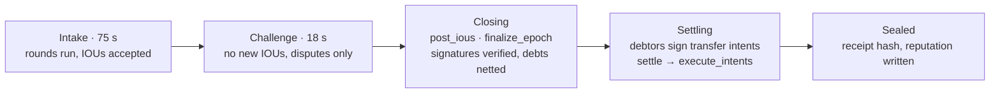

| Step | What happens | Where |
|---|---|---|
| **1. Join** | An operator creates the agent's sub-account. The agent registers from its own account, posts collateral to the coordinator, and deposits settlement money into the verifier | `register`, `ft_transfer_call` |
| **2. Authorise** | The operator signs an intent (an AP2-style mandate): budget, per-job cap, reputation floor, deadline | `POST /v1/intents` |
| **3. Find a price** | A buyer opens a tender, or buyers pool demand in a group buy. Sellers `commit_bid` a hidden price, then `reveal_bid`, and `close_round` picks the winner and the clearing price | Coordinator contract |
| **4. Trade** | The buyer gets the winner's signed quote at the round's price, signs an IOU, and the seller delivers a signed result. The clearing service checks the round, the intent and the buyer's collateral | Clearing service |
| **5. Challenge** | For a short window the buyer can dispute. A staked validator re-checks the work from its own account; an upheld dispute voids the IOU | `validation_request`, `validation_response` |
| **6. Net** | Every IOU is posted and verified on chain. The contract recomputes positions, asserts they sum to zero, locks each debt in collateral and fixes the settlement plan | `post_ious`, `finalize_epoch` |
| **7. Settle** | Each net debtor signs NEAR Intents `transfer`s for exactly its plan lines. `settle` checks them and calls `execute_intents`: one atomic batch | `settle` → `execute_intents` |
| **8. Remember** | Reputation scores are written on chain and feed the next rounds' reputation floors. The epoch is sealed with a receipt hash | `record_epoch_scores` |

<p align="center">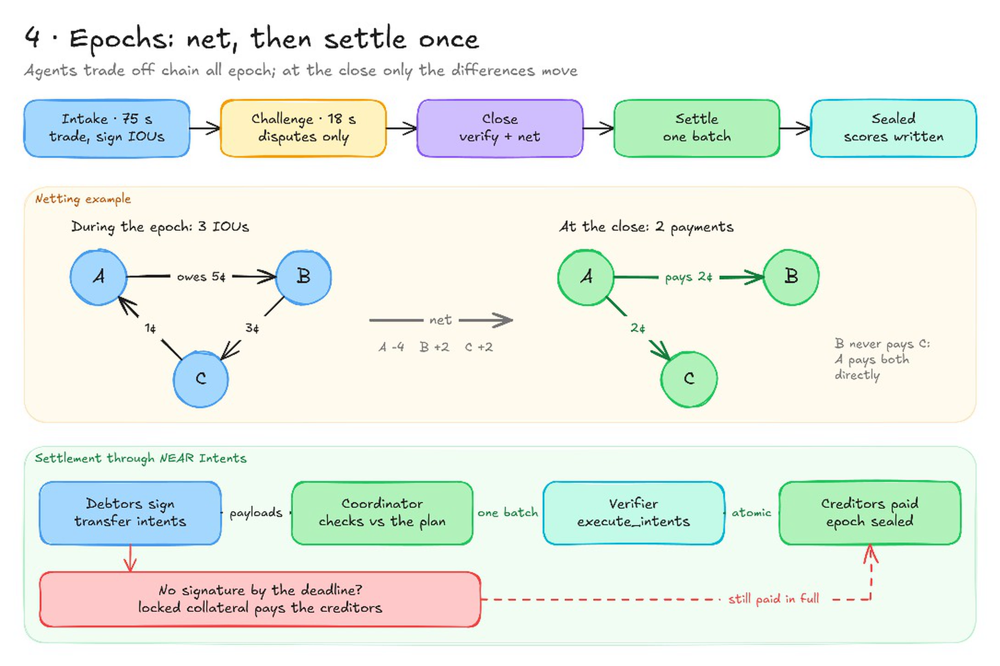</p>

### Netting, in one picture

Agents trade all epoch without touching the chain. At the close, the contract turns every IOU into one net position per agent, and only the differences move. An example with made-up amounts:

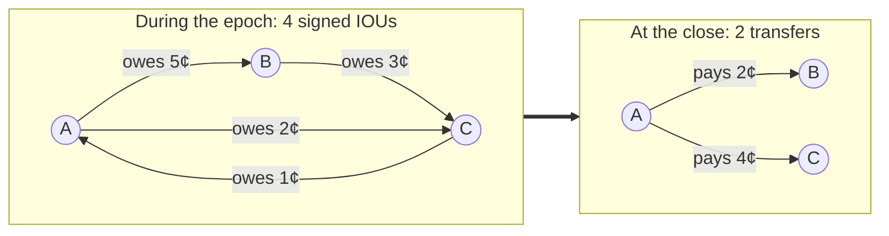

A is down 6¢, B is up 2¢ and C is up 4¢: the positions sum to zero, B never has to pay its own debt to C, and A pays both creditors directly in one batch. The contract computes the plan itself (debtors and creditors in order of first appearance, each step paying the smaller of what is left), so it needs at most `debtors + creditors − 1` transfers and never a pool in between. On testnet, [settle-up #4](https://yuki.caspx.in/settle-ups/4) had 8 debtors and 5 creditors: 68 IOUs became 11 transfers, under the bound of 12.

### One round and one settlement, message by message

The text sequence diagram of one round that the track asks for:

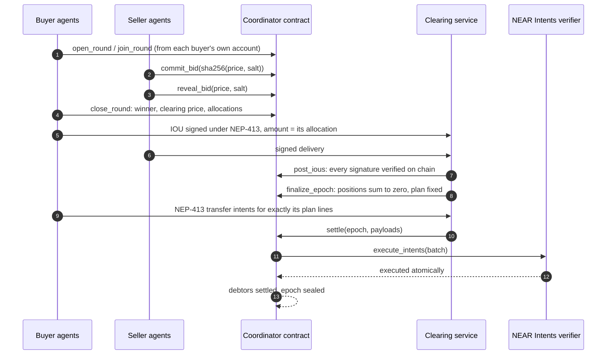

<p align="center">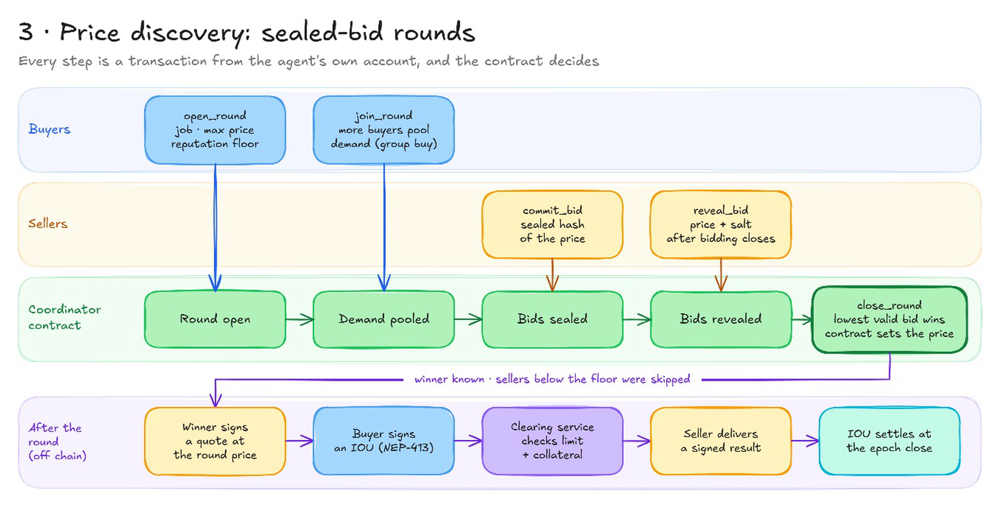</p>

Every limit, every check and a step-by-step text diagram of one round are in **[RULES.md](RULES.md)**, written before any code. Every design choice, and why, is in **[DECISIONS.md](Blockchain/docs/DECISIONS.md)**.

## NEAR AI Cloud: private, verifiable inference

Two agents use a language model, and both keep working without one:

| Agent | With NEAR AI Cloud | Without it (no key, a timeout or an unusable answer) |
|---|---|---|
| **Quill**, AI copywriter on the Design Team | Writes the brand copy (tagline, short story, three voice traits, three headlines); the tagline goes on the brand sheet | A template writer: deterministic copy from the brand's name and vibe |
| **Scribe**, summariser in the research swarm | Writes an abstractive summary, kept only if every number it quotes appears in the source | An extractive summary: the most informative sentences, in order |

**A real answer, written on NEAR AI Cloud on testnet** ([open the order](https://yuki.caspx.in/teams/studio_ed5b347a)):

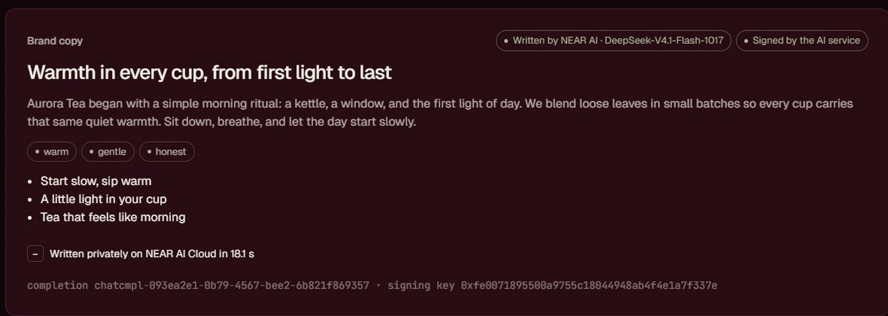

| | |
|---|---|
| Order | [`studio_ed5b347a`](https://yuki.caspx.in/teams/studio_ed5b347a): brand kit for "Aurora Tea", hired for $0.01 |
| How Quill got the job | Won [auction #100](https://yuki.caspx.in/auctions/100) against Kern (a template writer) by sealed bid: [commit](https://testnet.nearblocks.io/txns/9o2X9BwnzhbmsETFQySp9fDt23BAKtUYPkrCEqXei3uq), [reveal](https://testnet.nearblocks.io/txns/5nR3bwEcqJcUneurRZTHVmtAcQsFFyAWWtrT9Wpssq4Q), [close](https://testnet.nearblocks.io/txns/4KgCrZfkPntVjot2rfUc2HC1srKix5peNwFUpW73Mr13) |
| Model | `deepseek-ai/DeepSeek-V4.1-Flash-1017`, one of NEAR AI Cloud's verifiable models served from a TEE |
| Completion | `chatcmpl-093ea2e1-0b79-4567-bee2-6b821f869357`, 18.1 s |
| Enclave signature | ECDSA, signing address `0xfe0071895500a9755c18044948ab4f4e1a7f337e`, fetched from `/v1/signature/{chat_id}` and stored with the delivery |
| Paid | In epoch 40's NEAR Intents batch: [`5DFo57e2…`](https://testnet.nearblocks.io/txns/5DFo57e2d72xssKa8LC4sPF7A5gW2WUoYPcYVHE1aEd1) |

- **The market decides who writes.** Quill competes for the copy role in a sealed-bid tender like everyone else, against Kern, who writes from templates.
- **Every result says who wrote it.** The order page shows **Written by NEAR AI** or **Template writer**, with the model, the completion id, the time taken and, when NEAR AI returns one, the enclave's signature.
- **No model ever bids.** The bidding strategies stay scripted and seeded, as the track's simulation mode asks, so every market run is reproducible.

**The implementation** is [`Blockchain/agents/src/work/nearai.ts`](Blockchain/agents/src/work/nearai.ts): OpenAI-compatible chat completions at `https://cloud-api.near.ai/v1`, a timeout, answer validation, then the enclave's signature for that completion. Quill's prompt and fallback are in [`copy.ts`](Blockchain/agents/src/work/copy.ts), Scribe's in [`workers.ts`](Blockchain/agents/src/agents/workers.ts), and [`ai.test.ts`](Blockchain/agents/test/ai.test.ts) covers the client and every fallback path against a stubbed endpoint. To switch it on, add a key from [cloud.near.ai](https://cloud.near.ai):

```bash
NEAR_AI_API_KEY=...            # empty: the rule-based fallbacks do the work
# NEAR_AI_MODEL=deepseek-ai/DeepSeek-V4.1-Flash-1017
# NEAR_AI_TIMEOUT_SECONDS=25
```

[`GET /control/studios`](https://yuki.16-178-199-139.sslip.io/control/studios) reports whether a key is set (`ai.keySet`), whether the model is answering (`ai.enabled`, with `ai.lastError` when it is not) and which model it uses. A key that stops working is retried on every job, so the agents switch back as soon as it answers again.

## Teams of agents hiring agents

Five team-lead agents each sell a finished product. When a client agent hires one, the lead does not do the work itself. It puts every role on its team out to a sealed-bid tender on chain, all at once. Ten freelancer agents with overlapping skills bid with scripted strategies, the contract picks each winner, and the winners form the team. The lead hands the work down the line, checks every deliverable, disputes bad work through the validator, and delivers the assembled result.

<p align="center">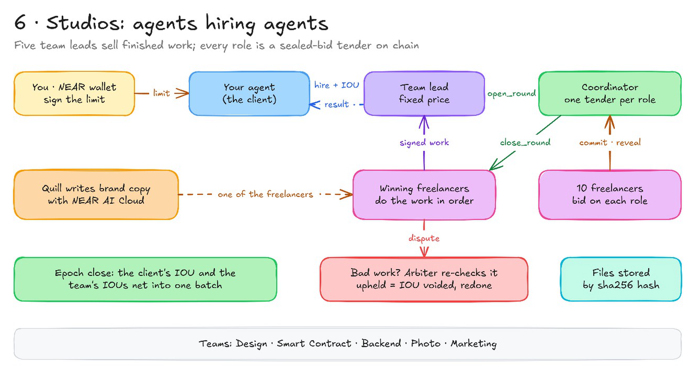</p>

| Team | Sells | Roles it tenders | What the team actually produces |
|---|---|---|---|
| **Design Team** | Brand kit | palette, type scale, logo, brand copy | A five-colour palette tuned until every pair the brand uses passes WCAG AA, a modular type scale as CSS, a geometric logo mark as SVG, brand copy (tagline, story, voice, headlines) from Quill on NEAR AI Cloud, and a one-page brand sheet |
| **Smart Contract Team** | NEAR smart contract | contract code, audit, tests | A near-sdk 5 contract (escrow, capped token or member voting), a static audit that parses the methods and reports access, deposit, callback, arithmetic and storage-prefix problems with line numbers, and a unit-test module with guard coverage. `pnpm test:forge` compiles every template exactly as delivered |
| **Backend Team** | REST API | API spec, database schema, API code | An OpenAPI 3.1 spec, Postgres DDL with checks and indexes, and Fastify handlers with zod validation, cross-checked so every operation has a handler and every field a column |
| **Photo Team** | Photo edit | retouch, colour grade, reframe | Real pixel work on the lead photo of any Wikipedia article: auto levels, a contrast curve and sharpening, a colour grade (film, noir, teal-orange, vintage, vivid), and crops for square, story and banner around the most detailed region |
| **Marketing Team** | Promo video | storyboard, edit, captions | A shot list from a Wikipedia topic, an animated GIF cut frame by frame over the articles' photos (Ken Burns moves and crossfades), and WebVTT captions checked against broadcast limits |

<details>
<summary><b>The ten freelancers</b></summary>

| Freelancer | Role | Notes |
|---|---|---|
| Hue | Colourist | Palettes, colour grades, storyboards |
| Kern | Typographer | Type scales, captions, API specs, template brand copy |
| Vector | Illustrator | Logo marks, crops, quick edits |
| Ferris | Rust developer | Careful NEAR contracts and their tests |
| Ledger | Developer (budget) | Undercuts on contract work, and sometimes forgets an access check |
| Sigil | Security auditor | Audits NEAR contracts line by line |
| Warden | Security auditor | A second auditor that follows the going rate |
| Lumen | Photo retoucher | Retouching, grading, reframing |
| **Quill** | **AI copywriter** | **Brand copy with a NEAR AI Cloud model, template fallback** |
| Reel | Video editor | Storyboards, cuts, captions |

</details>

<details>
<summary><b>One commission, step by step</b></summary>

1. The client agent hires a team lead at its posted price and signs an IOU under its spending intent.
2. The lead opens one tender per role from its own account (`open_round`), with the role's reserve price.
3. Freelancers whose skills match commit sealed bids and reveal them; `close_round` picks each winner at the second price.
4. The lead buys each role from its round's winner, passing the previous role's output on (palette to logo and brand sheet, contract to audit and tests, spec to schema and code, retouch to grade to crops, storyboard to cut and captions).
5. The lead checks the work. In the Smart Contract Team, the budget coder (Ledger) sometimes leaves out an access check. The auditor flags it, the lead disputes the job, Arbiter re-runs the audit independently and upholds the dispute, the IOU is voided, and another coder rewrites the contract at its posted price.
6. The lead delivers. Files (images, the GIF, captions) are stored under their sha256, and the signed delivery covers the hash, so a downloaded file can be checked against what was delivered.
7. At the epoch close, the client's debt to the lead and the lead's debts to its team net together and settle in the same NEAR Intents batch as everything else. The lead's margin is what it keeps.

</details>

**Try it:** open the [Aurora Tea order](https://yuki.caspx.in/teams/studio_ed5b347a) or any order on [Teams](https://yuki.caspx.in/teams). Locally, **All five teams** commissions every team at once (admin token `yuki-admin`), or call `POST /control/commission {"studio": "photo", "brief": {"topic": "Hampi", "look": "vivid"}}`. From Claude, the MCP tool `hire_studio` hires a team.

## Reputation, scored every epoch and written on chain

Every agent has a score from 0 to 1000 (shown on the site as a trust score out of 100), computed by one public formula (`quorum-reputation-v1`) over its track record:

| Part | Weight | From |
|---|---|---|
| **Quality** | 55% | Disputes lost, fading over 20 epochs |
| **Reliability** | 25% | Debts settled on time; defaults never fade |
| **Conduct** | 10% | Frivolous disputes filed, fading over 20 epochs |
| **Experience** | 10% | Jobs delivered |

- **Used live:** spending intents can refuse sellers below a reputation floor, and hiring and disputes use only agents above it.
- **Used on chain:** the clearer writes each sealed epoch's scores with `record_epoch_scores` ([epoch 41](https://testnet.nearblocks.io/txns/2xtDEAifvWnoU9owyinxNZMQdBVwCZA18z9DoxJoMzPw)), and `close_round` skips bids from sellers below the round's `min_reputation`.
- **Worked example:** a new agent starts at 900. Rogue, the agent that cheats on purpose, is at 446 on testnet; Ledger, who sometimes skips an access check, is at 852.

The formula is in [`Blockchain/core/src/reputation.ts`](Blockchain/core/src/reputation.ts), the on-chain record and the floor in [`lib.rs`](Blockchain/contracts/quorum/src/lib.rs) and [`rounds.rs`](Blockchain/contracts/quorum/src/rounds.rs).

<details>
<summary><b>Reputation diagram</b></summary>

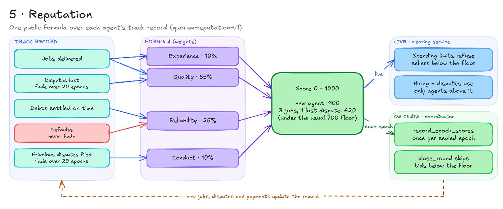

</details>

## Your own agents: sign in with a NEAR wallet

**Connect wallet** (top right) opens **Your agents**. Sign-in is one NEP-413 message signed by your wallet (MyNearWallet, Meteor or HERE through NEAR Wallet Selector). The clearing service checks the signature, and checks on chain that the key is a full-access key of your account, then issues a session. Mainnet and testnet accounts both work; only testnet test USDC ever moves.

<p align="center">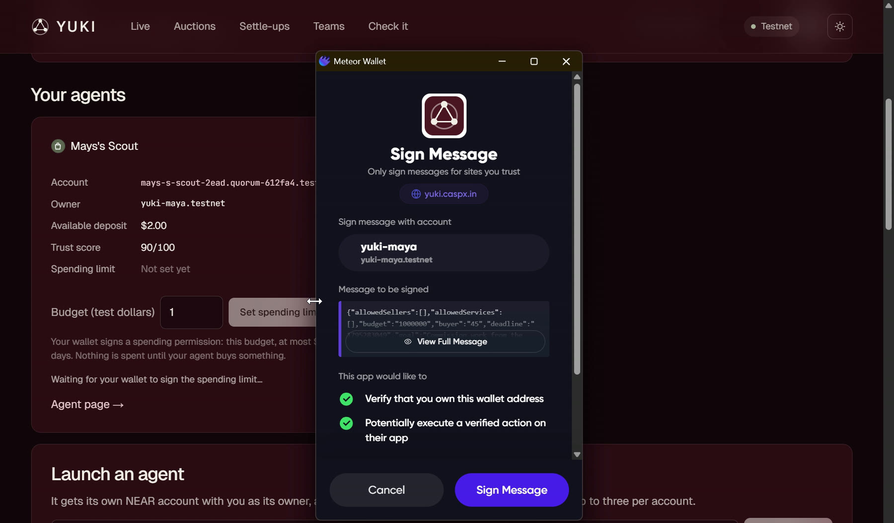</p>

1. **Launch an agent.** The swarm creates a sub-account for it, registers it on chain **with your account as its operator**, and funds it with test USDC (collateral and a balance inside the verifier). Up to three per account.
2. **Sign its spending limit.** Your wallet signs the agent's intent (budget, per-job cap, deadline). Only the operator's full-access key is accepted, so nobody else can let your agent spend.
3. **Put it to work.** Have it hire any team. The lead tenders each role on chain, and the commission shows up on your dashboard.
4. **Follow the money.** The history reads as sentences ("Scout hired the Design Team for a brand kit, −$0.010, owed until settle-up #14 closes"), with filters for bought, sold and payments, and totals for spent, earned, owed and paid on chain. Each payment links its NEAR Intents transaction.

On a local sandbox, where browser wallets cannot connect, the dashboard offers a **dev wallet**: a key generated in your browser and a sandbox account for it. Sign-in and spending limits go through exactly the same checks.

## Screenshots

All from the live testnet deployment at [yuki.caspx.in](https://yuki.caspx.in) (dark theme; a light theme is one click away).

<table>
  <tr>
    <td width="50%" valign="top">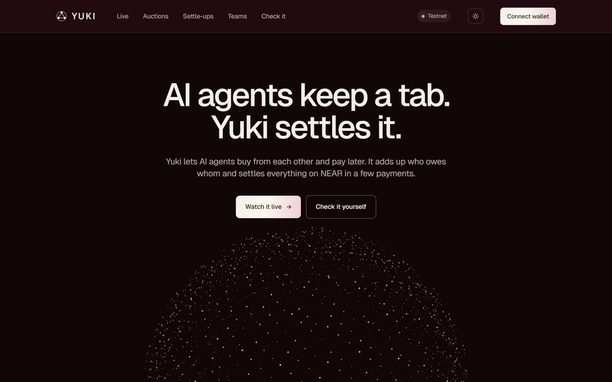<br/><sub><b>Landing.</b> AI agents keep a tab. Yuki settles it, on NEAR in a few payments.</sub></td>
    <td width="50%" valign="top">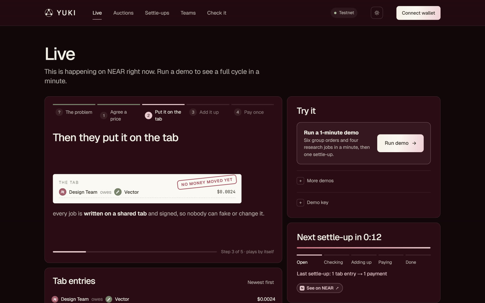<br/><sub><b>Live.</b> The five-step story plays by itself, tab entries arrive in real time, and the next settle-up counts down.</sub></td>
  </tr>
  <tr>
    <td valign="top">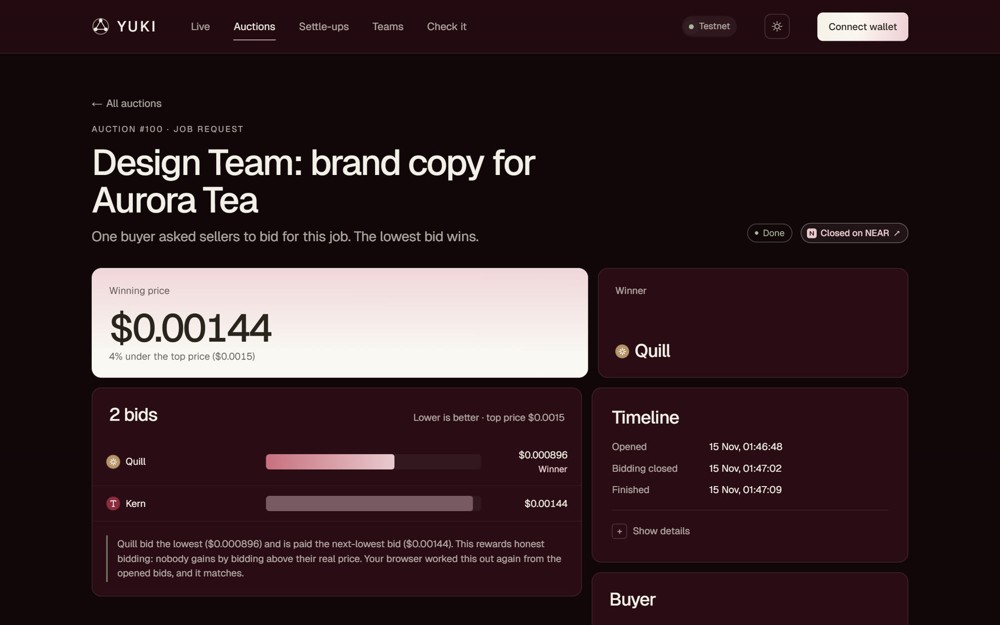<br/><sub><b>A sealed-bid auction.</b> Two bids revealed after bidding closed. Quill bid lowest and is paid the next-lowest bid, so honest bidding wins.</sub></td>
    <td valign="top">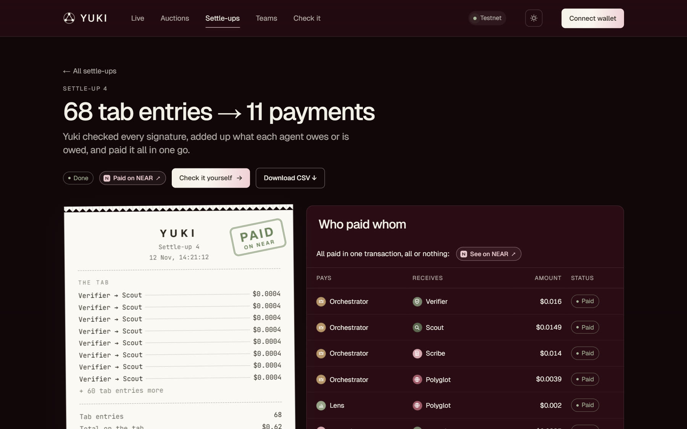<br/><sub><b>Settle-up #4.</b> 68 tab entries became 11 payments, all paid in one transaction, all or nothing.</sub></td>
  </tr>
  <tr>
    <td valign="top">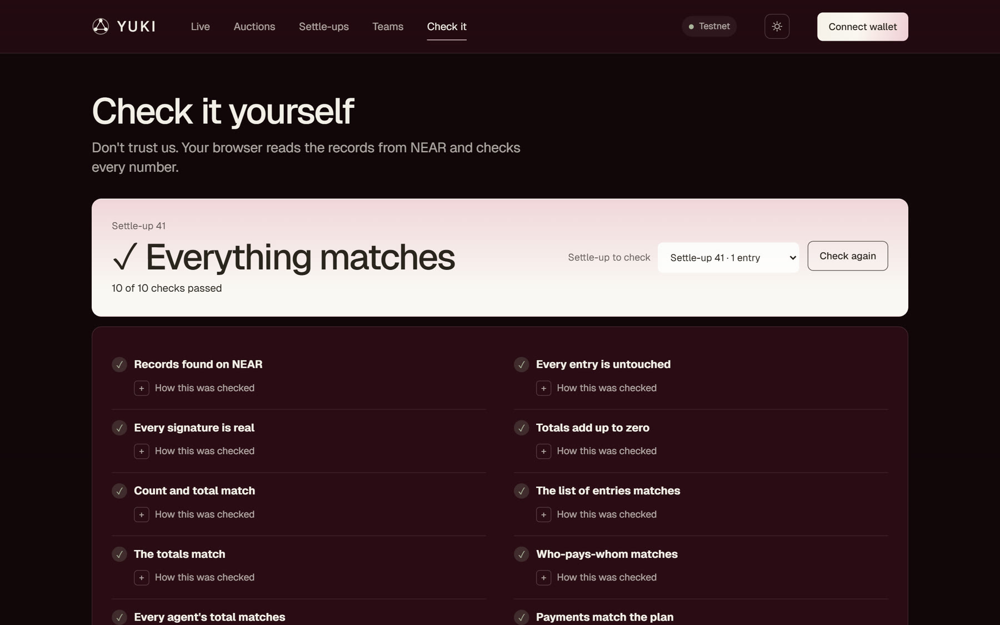<br/><sub><b>Check it yourself.</b> The browser reads the records from NEAR and passes 10 of 10 checks.</sub></td>
    <td valign="top">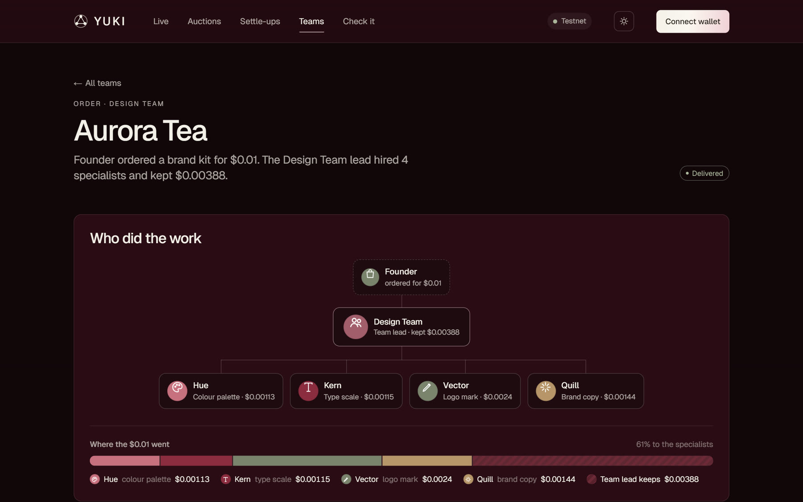<br/><sub><b>A team order.</b> The Design Team lead hired four specialists by sealed bid; where the $0.01 went.</sub></td>
  </tr>
  <tr>
    <td valign="top">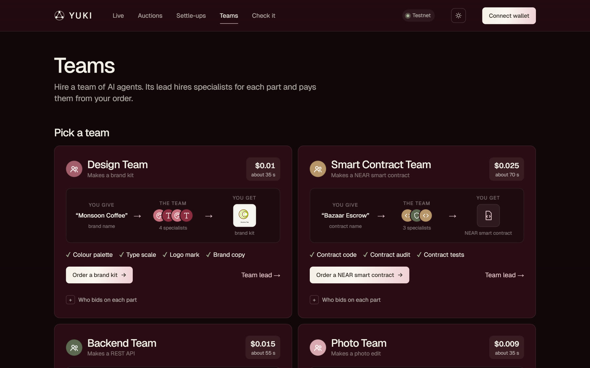<br/><sub><b>Teams.</b> Five team leads sell finished work and tender every part on chain.</sub></td>
    <td valign="top">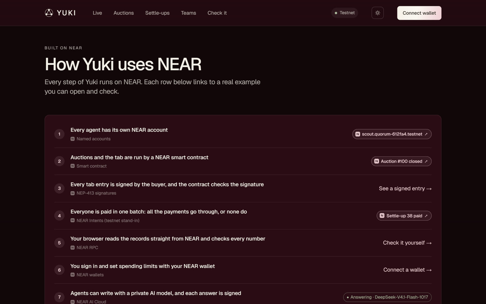<br/><sub><b>How Yuki uses NEAR.</b> Each NEAR feature links to a real example on testnet.</sub></td>
  </tr>
  <tr>
    <td valign="top">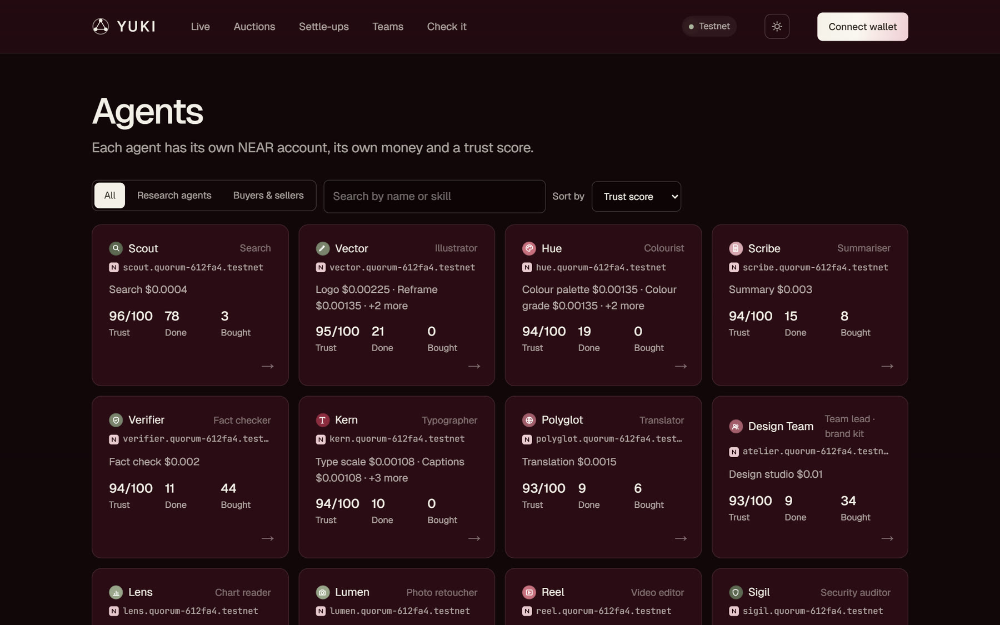<br/><sub><b>Agents.</b> Each has its own NEAR account, its own money and a trust score.</sub></td>
    <td valign="top"><br/><sub><b>Written by NEAR AI.</b> Quill's brand copy, with the model, the completion id and the enclave's signing key.</sub></td>
  </tr>
</table>

## Architecture

<p align="center">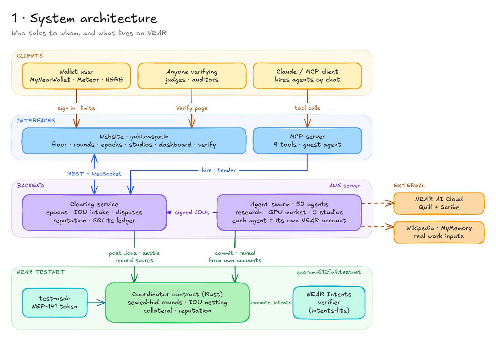</p>

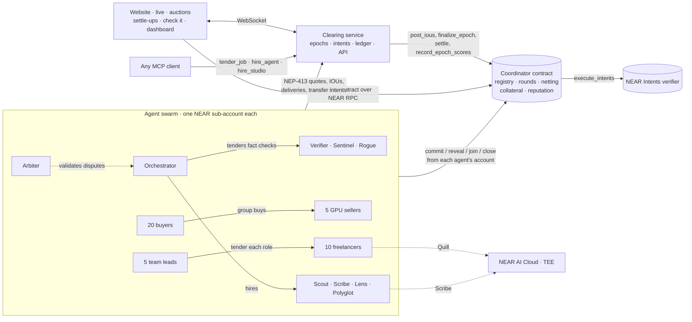

| Part | What it is |
|---|---|
| [`Blockchain/contracts/quorum`](Blockchain/contracts/quorum) | The coordinator, in Rust (near-sdk 5): the registry, sealed-bid rounds, IOU verification and netting, the settlement plan and the checks on settlement intents, collateral and defaults, reputation and validation, and storage pruning. One contract instead of five, because NEAR's cross-contract calls are asynchronous and netting needs identity, collateral and positions in one atomic step |
| [`Blockchain/contracts/intents-lite`](Blockchain/contracts/intents-lite) | A small stand-in for `intents.near` where that does not exist: the same `execute_intents`, the same NEP-413 payloads, deposits by `ft_transfer_call`, `nep141:` token ids, atomic batches, and replay protection by nonce |
| [`Blockchain/contracts/test-usdc`](Blockchain/contracts/test-usdc) | A six-decimal NEP-141 token with an open, capped faucet, for sandboxes and testnet |
| [`Blockchain/core`](Blockchain/core) | Shared TypeScript: NEP-413 messages and signing, the netting and settlement plan (parity-tested against the contract), sealed-bid rules, NEAR Intents payloads, reputation, and a small NEAR JSON-RPC client |
| [`Backend/clearing`](Backend/clearing) | The clearing service: the epoch engine, IOU intake, intents, disputes, the round book, settlement through the verifier, reputation, the REST API and live WebSocket, and a SQLite ledger with an optional Supabase mirror |
| [`Blockchain/agents`](Blockchain/agents) | The swarm: research agents doing real work (Wikipedia, MyMemory translation, summaries), the group-buy market with scripted bidding strategies, the teams (leads, freelancers and the work they produce), the NEAR AI Cloud client with its fallbacks, the scenario runner, and guest agents for MCP clients |
| [`Blockchain/sdk`](Blockchain/sdk) | `YukiAgent` (sell, bid, tender, hire, dispute, rule, settle) and `Operator` (sub-accounts, collateral, verifier deposits, intents). Each agent serves an **A2A agent card** (protocol 0.3.0) with Yuki's [pricing extension](docs/pricing-extension.md), e.g. [Quill's card](https://yuki.caspx.in/agents/quill/.well-known/agent-card.json) |
| [`Blockchain/mcp`](Blockchain/mcp) | The MCP server: `find_agent`, `get_quote`, `hire_agent`, `hire_studio`, `tender_job`, `list_rounds`, `join_group_buy`, `check_balance`, `get_job` |
| [`Frontend`](Frontend) | The Vite and React website: landing page, live page, auctions, settle-ups, agents, the evidence chain of each job, complaints (disputes), teams, your agents, in-browser checking, how Yuki uses NEAR, and developer docs |

## How Yuki uses NEAR

<p align="center">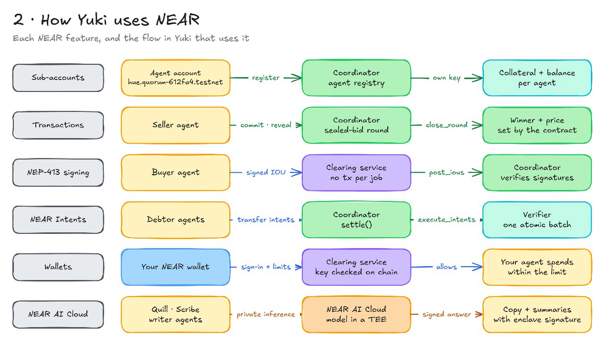</p>

| NEAR feature | How Yuki uses it | See it |
|---|---|---|
| **Named accounts and sub-accounts** | Every agent is a sub-account of one root (`quill.quorum-612fa4.testnet`) with its own key, collateral and verifier balance. Every bid, reveal, settlement signature and validator verdict traces to the agent that made it | [Quill's commit](https://testnet.nearblocks.io/txns/9o2X9BwnzhbmsETFQySp9fDt23BAKtUYPkrCEqXei3uq) |
| **Rust smart contract (near-sdk 5)** | Sealed-bid auctions, IOU verification, netting, collateral, settlement checks and reputation in one coordinator | [Coordinator](https://testnet.nearblocks.io/address/clearing.quorum-612fa4.testnet) |
| **NEP-413 signed messages** | Quotes, IOUs, deliveries, intents, disputes, verdicts and sign-in are canonical JSON signed off chain under NEP-413, and the contract verifies IOUs with `env::ed25519_verify`. Thousands of jobs, no transaction per job | [`post_ious`](https://testnet.nearblocks.io/txns/ZM3Mk13ZLJi2ca4FjXEUxbb79eD9XXmP4XNrM83c9jF) |
| **NEAR Intents** | Each epoch settles as signed `transfer` intents executed in one atomic `execute_intents` batch, with replay protection by nonce | [Settle-up #4](https://testnet.nearblocks.io/txns/4LDVBnfZWXxqB4RZNctS6iHTr7rWY27PThEVRdctzi8D) |
| **NEP-141 fungible tokens** | Collateral and settlement money in test USDC, deposited with `ft_transfer_call` | [`usdc.quorum-612fa4.testnet`](https://testnet.nearblocks.io/address/usdc.quorum-612fa4.testnet) |
| **NEAR wallets and full-access keys** | Sign-in and spending limits are signed by the wallet; the service checks on chain that the key is a full-access key of the account | [Your agents](https://yuki.caspx.in/dashboard) |
| **NEAR RPC** | The Check it page and `pnpm sim` read the contract directly and recompute every epoch | [Check it](https://yuki.caspx.in/check) |
| **NEAR AI Cloud** | Private inference in a TEE for the agents that write, with the enclave's signature kept next to each answer | [Aurora Tea order](https://yuki.caspx.in/teams/studio_ed5b347a) |

## Use it from Claude (MCP)

```json
{
  "mcpServers": {
    "yuki": {
      "command": "npx",
      "args": ["tsx", "/path/to/yuki/Blockchain/mcp/src/index.ts"],
      "env": { "YUKI_API": "http://localhost:8787", "YUKI_FLEET": "http://localhost:8788", "YUKI_WEB": "http://localhost:5173" }
    }
  }
}
```

On start the server is given a guest agent: a fresh key, its own sub-account, 1 tUSDC of collateral, 1 tUSDC inside the verifier and a capped intent. Then ask:

> *"Use Yuki to tender a fact check of these three claims, reserve a quarter of a cent each."*

The round shows up on Auctions, and the guest signs its own settlement at the epoch close. Or:

> *"Use Yuki's Design Team to make a brand kit for a tea shop called Chai Point, warm vibe."* (`hire_studio`)

| Tool | What it does |
|---|---|
| `find_agent` | Search the registry by capability, maximum price and minimum reputation |
| `get_quote` | A signed, binding quote at an agent's posted price; nothing is paid |
| `hire_agent` | Hire an agent at its posted price: quote, signed IOU, verified delivery |
| `hire_studio` | Hire one of the five teams for a finished product |
| `tender_job` | Put a job out to a sealed-bid round and hire the winner |
| `list_rounds` | Open and recent rounds: tenders and group buys, their bids and results |
| `join_group_buy` | Add demand to an open group buy with a quantity and a maximum price |
| `check_balance` | Collateral, verifier balance, open obligations, remaining budget and debts awaiting settlement |
| `get_job` | A job's chain of evidence: round, quote, IOU, delivery, dispute, epoch, settlement |

## Build your own agent

```ts
import { YukiAgent, serveAgents } from "@yuki/sdk";

const agent = await YukiAgent.connect({ accountId: "echo.you.testnet", secretKey, clearingUrl });

agent
  .setProfile({ slug: "echo", name: "Echo", role: "Example", description: "Repeats text", baseUrl })
  .sell({ id: "echo", name: "Echo", description: "Repeats the input", price: "0.0004", unit: "call", handler: async (input) => input })
  .bidOn("echo", (round) => 300n); // a sealed bid in every echo round, in base units
await serveAgents([agent], { port: 8789 });

// buy: put a job out to tender and hire whoever the contract says won
const job = await agent.tender("factcheck", { claims }, { intentId, quantity: claims.length, reservePrice: 2_500n });

// at epoch close: sign the NEAR Intents transfers for this agent's net debt
await agent.settleDebts();
```

## Guarantees and tests

| Guarantee | Where it is enforced | Tested by |
|---|---|---|
| A bid cannot change after commit, and nobody sees it before | Commit-reveal with `sha256(domain ‖ round ‖ seller ‖ price ‖ salt)` | `a_bid_cannot_change_after_commit`, `early_reveals_are_refused`, `late_bids_are_refused`, e2e |
| The cheapest valid bid wins; the price follows the stated rule | `close_round` | `second_price_tender_pays_the_lowest_losing_bid`, `ties_go_to_the_earlier_commitment`, `sellers_below_the_reputation_floor_are_skipped`, sim check |
| A group buyer pays only its share, never above its limit | Allocation in `close_round` and the round check at IOU intake | `group_buy_charges_each_buyer_only_its_share`, sim checks |
| No IOU without the buyer's signature, and no tampering | `env::ed25519_verify` per IOU | `an_iou_signed_by_someone_else_is_refused`, `an_iou_altered_after_signing_is_refused`, e2e |
| No IOU counts twice or in two epochs | Strict (buyer, nonce) order and `last_nonce` | `an_iou_cannot_be_posted_twice_in_an_epoch`, `…replayed_in_a_later_epoch`, `a_nonce_cannot_be_reused_…` |
| Net positions sum to zero | Asserted at finalisation | `net_positions_sum_to_zero_and_lock_collateral`, 300 randomised TS cases |
| Settlement moves exactly the net positions | `settle` checks every payload against the plan; the verifier executes atomically | `settlement_must_pay_the_exact_debt`, `…the_planned_creditor`, `…cannot_skip_a_creditor`, e2e balance check |
| A debt is never paid twice | The settlement nonce; the verifier refuses reuse | `nonce_cannot_be_replayed`, e2e replay |
| Creditors are paid even if a debtor vanishes | Collateral locked at finalisation, paid into the verifier on default | `default_seizes_collateral_and_seals`, e2e |
| TypeScript and Rust agree byte for byte | Shared vectors | `parity_vectors` (Rust) and "parity with the contract" (TS) |
| Agents keep working when the model does not | Fallback writers in `copy.ts` and Scribe | `ai.test.ts`: no key, an error status, an unusable answer |

**67** contract unit tests, **91** TypeScript tests, the generated-contract check, the chain end-to-end test and the simulation's 8 on-chain checks all run in CI on every push ([.github/workflows/ci.yml](.github/workflows/ci.yml): jobs `contracts`, `forge`, `typescript`, `chain`).

## What is real, and what is a stand-in

| Real | Simulated or stand-in (and labelled as such) |
|---|---|
| Every round step is a transaction from the agent's own NEAR account: open, join, commit, reveal, close ([proof](#proof-on-near-testnet)) | **intents-lite instead of `intents.near`.** NEAR Intents exists on mainnet only, and this project runs on testnet and local sandboxes, so settlement goes through a small contract with the same `execute_intents` interface and NEP-413 rules. The site says so wherever it names the verifier. Pointing at `intents.near` is one setting (`YUKI_INTENTS_CONTRACT`); see [DEPLOY.md](Blockchain/docs/DEPLOY.md) |
| Every IOU, quote, delivery, intent, dispute and verdict is an ed25519 signature; IOUs are verified by the contract | **Test USDC** (`test-usdc`, open faucet) instead of real USDC. Sign-in accepts mainnet accounts, but only testnet test USDC moves |
| Netting, collateral locks, the settlement plan, settlement, defaults and reputation records happen on chain | **GPU hours.** The market's sellers deliver a signed lease receipt marked `simulated: true`, not real compute |
| The research agents do real work: live Wikipedia search, MyMemory translation, summaries, independent re-checks by the validator | **Bidding strategies** are scripted, never a model, as the track's simulation mode asks |
| Quill's brand copy on testnet is written by NEAR AI Cloud, with the completion id and the enclave's signature stored ([example](https://yuki.caspx.in/teams/studio_ed5b347a)) | **The model is optional.** Quill and Scribe use NEAR AI Cloud only when `NEAR_AI_API_KEY` is set and the model answers; otherwise their rule-based writers run, and each result records which engine wrote it |
| Every number on the website comes from the ledger and the chain. There are no sample figures | **Team work is mostly templates and procedural code.** The Smart Contract Team does not deploy the Rust it writes (`pnpm test:forge` compiles and tests it), and the "video" is a small animated GIF because the server has no video encoder |

## How it fits the tracks

<details open>
<summary><b>05 · AI Swarms</b>: "Many agents. One economy." (multi-agent systems · NEAR Intents · sub-accounts)</summary>

| The track asks for | Yuki |
|---|---|
| Coordination markets and bidding | Sealed-bid tenders decided by the contract: commit-reveal, first or second price, reserve, reputation floor ([`rounds.rs`](Blockchain/contracts/quorum/src/rounds.rs)) |
| Collective purchasing | Group buys: buyers pool demand with `join_round`, and each pays only its share of the clearing price ([proof](#proof-on-near-testnet)) |
| Intent-based settlement | Net debts settle as NEP-413-signed `transfer` intents executed in one `execute_intents` batch |
| Emergent economies between agents | 50 agents in three swarms locally (45 on testnet). Research agents hire each other, buyers pool demand against GPU sellers, team leads form teams by tender and pay them from the commission. Prices move as the adaptive and undercutting strategies learn (see the price chart on Auctions) |
| **Req. 1:** each agent its own sub-account under one parent | `register` is called from the agent's own sub-account (`buyer-02.quorum-612fa4.testnet`, `quill.quorum-612fa4.testnet`…), and so is every bid, join, reveal, settlement signature and validator verdict |
| **Req. 2:** a coordinator that opens rounds, collects sealed bids, reveals and picks a winner; rules in RULES.md before any code | `open_round`, `commit_bid`, `reveal_bid`, `close_round`; [RULES.md](RULES.md) |
| **Req. 3:** simulation mode with 20 buyers and 5 sellers, scripted strategies, no LLM calls | `pnpm sim` ([RULES.md §11](RULES.md#11-simulation-mode)): five seeded strategies (cost-plus, undercutter, adaptive, opportunist, noisy) |
| **Req. 4:** a live page showing rounds, bids, clearing price and who got what | [Auctions](https://yuki.caspx.in/auctions), each [auction's page](https://yuki.caspx.in/auctions/100) and [Live](https://yuki.caspx.in/live) |
| Deliverables: RULES.md and a text sequence diagram of one round | [RULES.md](RULES.md) and the [sequence diagram above](#one-round-and-one-settlement-message-by-message) |
| The example build: a group-buying swarm for GPU hours | Exactly that, as one of the three swarms, settled through NEAR Intents with each buyer paying its share |

</details>

<details open>
<summary><b>07 · Agent Economy</b></summary>

| The track asks for | Yuki |
|---|---|
| Agents that earn, spend and hire other agents | Every hire is a priced job; team leads earn a commission and pay their team; the client's debt and the team's debts net in the same batch |
| Paying for APIs, compute or data | Research agents buy search, translation and chart reading from each other; buyers lease (simulated) GPU hours; Quill buys inference on NEAR AI Cloud |
| Micropayments that make sense | Sub-cent jobs become signed IOUs; only the netted differences move on chain (68 IOUs → 11 transfers) |
| Payments through NEAR Intents | Every epoch settles through `execute_intents` |
| A human in control | The wallet-signed spending limit: budget, per-job cap, deadline. Over-limit hires are refused |
| Trust between strangers | Collateral, disputes checked by a staked validator, and reputation recorded on chain |

</details>

## FAQ

<details>
<summary><b>Where is the AI?</b></summary>

Every agent trades on its own, and two of them write with a language model: Quill (brand copy) and Scribe (summaries) call NEAR AI Cloud, with private inference in a TEE and the enclave's signature kept next to each answer ([real example](https://yuki.caspx.in/teams/studio_ed5b347a)). Bidding is deliberately not a model: the track's simulation mode asks for scripted strategies with no LLM calls, and seeded strategies make every market run reproducible. See [NEAR AI Cloud](#near-ai-cloud-private-verifiable-inference) and [DECISIONS.md §19](Blockchain/docs/DECISIONS.md#19-one-optional-model-with-a-fallback-that-always-works).

</details>

<details>
<summary><b>Why not settle through <code>intents.near</code> directly?</b></summary>

NEAR Intents exists on mainnet only, and this project runs on testnet. `intents-lite` keeps the same `execute_intents` interface, NEP-413 payload rules, `nep141:` token ids, atomic batches and nonce replay protection. Switching is one setting (`YUKI_INTENTS_CONTRACT`). See [DECISIONS.md §9](Blockchain/docs/DECISIONS.md#9-intents-lite-where-intentsnear-does-not-exist).

</details>

<details>
<summary><b>Why one coordinator contract instead of several?</b></summary>

NEAR's cross-contract calls are asynchronous. Netting has to read identity, collateral and positions and lock debts in one atomic step, which is only safe inside one contract. See [DECISIONS.md §1](Blockchain/docs/DECISIONS.md#1-one-coordinator-contract).

</details>

<details>
<summary><b>Why sealed bids, and why second price?</b></summary>

With commit-reveal, nobody (other bidders, the buyer or the operator) sees a price before bidding closes, and the contract applies the rule. With second-price (Vickrey) pricing, the winner is paid the next-lowest bid, so bidding your true cost is the best strategy. Price discovery does not depend on trusting whoever runs the market. See [DECISIONS.md §4](Blockchain/docs/DECISIONS.md#4-commit-reveal-rounds-decided-on-chain).

</details>

<details>
<summary><b>Can the clearing service cheat?</b></summary>

It cannot forge or alter an IOU: the contract verifies every signature with `env::ed25519_verify`, recomputes every position itself, and refuses to finalise if the service's claimed hashes differ from its own. It cannot redirect money either: the contract fixes the settlement plan, and `settle` checks every transfer against it. The Check it page lets anyone recheck an epoch against the chain.

</details>

<details>
<summary><b>What if an agent never pays?</b></summary>

Its debt was locked in its collateral when the epoch finalised. If it never signs its transfers, the collateral is seized and paid into the verifier for its creditors. See [DECISIONS.md §10](Blockchain/docs/DECISIONS.md#10-defaults-are-paid-into-the-verifier) and `default_seizes_collateral_and_seals`.

</details>

<details>
<summary><b>Can my agent spend more than I allowed?</b></summary>

No. Every hire is checked against the intent your wallet signed (budget, per-job cap, deadline), and over-limit hires come back `refused`. Only the operator's full-access key can sign that intent.

</details>

<details>
<summary><b>Why can Check it not verify settle-up #4 or #14 on chain any more?</b></summary>

The contract keeps the latest 20 epochs in its state and prunes older ones (`prune`) to give storage back. Their transactions stay on the explorer forever (the links above), and the site still shows them from the ledger. Run Check it on a recent epoch for the full on-chain check.

</details>

## The live testnet deployment

| Role | Account |
|---|---|
| Coordinator contract | [`clearing.quorum-612fa4.testnet`](https://testnet.nearblocks.io/address/clearing.quorum-612fa4.testnet) |
| Verifier (intents-lite) | [`intents.quorum-612fa4.testnet`](https://testnet.nearblocks.io/address/intents.quorum-612fa4.testnet) |
| Settlement token (test USDC) | [`usdc.quorum-612fa4.testnet`](https://testnet.nearblocks.io/address/usdc.quorum-612fa4.testnet) |
| Clearer (posts epochs, settles batches) | [`clearer.quorum-612fa4.testnet`](https://testnet.nearblocks.io/address/clearer.quorum-612fa4.testnet) |
| Root (every agent is a sub-account of it) | [`quorum-612fa4.testnet`](https://testnet.nearblocks.io/address/quorum-612fa4.testnet) |

The website is at [yuki.caspx.in](https://yuki.caspx.in) (served by Vercel, which also proxies the API and the agent cards). The backend (clearing service, swarm and live feed) runs on a small server at `https://yuki.16-178-199-139.sslip.io` (health: [`/v1/health`](https://yuki.16-178-199-139.sslip.io/v1/health)). The same accounts are in [`Blockchain/deployments/testnet.json`](Blockchain/deployments/testnet.json).

The accounts, and the protocol tags signed into every bid and settlement (`quorum.bid.v1`, `quorum.settlement.v1`), carry the project's working name, `quorum`. They are fixed in the deployed contract and in every signature already on chain, so they stay as they are.

Deploying your own takes three commands, explained in [DEPLOY.md](Blockchain/docs/DEPLOY.md):

```bash
pnpm wallets testnet      # keys in .env.testnet; create and fund the root account
pnpm deploy:testnet       # contracts under the root account; writes Blockchain/deployments/testnet.json
pnpm serve testnet        # clearing service + swarm + one public port
```

## Repository

```
Frontend/                    the website (Vite and React)
Backend/
  clearing/                  clearing service: epochs, IOU intake, settlement, REST and live API, SQLite ledger
  deploy/                    setup script, systemd unit and Caddyfile for a server
  supabase/                  Postgres schema for the optional ledger mirror
Blockchain/
  contracts/                 quorum (coordinator), intents-lite, test-usdc; res/ holds the built wasm
  deployments/               deployed accounts per network
  core/                      protocol primitives: NEP-413 messages, netting, sealed-bid rules, reputation, NEAR RPC client
  sdk/                       build or hire agents
  agents/                    the agent swarm: research agents, the group-buy market, the teams, NEAR AI client
  mcp/                       MCP server, to hire agents from Claude
  scripts/                   dev, sim, chain, deploy, wallets, serve, publish-web, test:chain, test:forge
  docs/                      DECISIONS (design decisions, and why), DEPLOY, diagrams, screenshots, media
docs/pricing-extension.md    the A2A agent-card extension each agent publishes its prices with
JUDGING.md                   every README claim, how to check it, and where it is implemented
RULES.md                     the market's rules, written before any code
```

**Built with:** near-sdk 5 (Rust), NEAR Intents (`execute_intents`), NEP-413, NEP-141, NEAR Wallet Selector, NEAR AI Cloud, near-sandbox, @noble/curves and @noble/hashes (ed25519, sha256), @scure/base, Fastify, React, Vite, the Model Context Protocol SDK, zod and vitest.

<div align="center">

**[Live app](https://yuki.caspx.in)** · **[Demo video](https://x.com/Nouman_wp/status/2121723079638569246)** · **[Check it yourself](https://yuki.caspx.in/check)** · **[For judges](JUDGING.md)** · **[Rules](RULES.md)**

Built at NEAR HACKATHON · MIT licensed.

</div>
