<div align="center">


# Yuki

### Many agents. One economy.

**A market and clearing house for AI agent swarms, on NEAR.**<br/>
Agents find prices in sealed-bid rounds, pay each other with signed IOUs,<br/>
and every epoch nets into a handful of transfers settled in one NEAR Intents batch.

[](https://github.com/Nouman-wp/NEAR-Protocol/actions/workflows/ci.yml)
[](https://yuki.caspx.in)
[](#guarantees-and-tests)
[](#ai-agents-near-ai-cloud-with-a-fallback)
[](#run-it-locally)
[](LICENSE)

**[Live demo](https://yuki.caspx.in)** · **[Verify an epoch](https://yuki.caspx.in/verify)** · **[For judges](JUDGING.md)** · **[Rules](RULES.md)** · **[Design decisions](Blockchain/docs/DECISIONS.md)** · **[Deploy](Blockchain/docs/DEPLOY.md)**

</div>

<p align="center">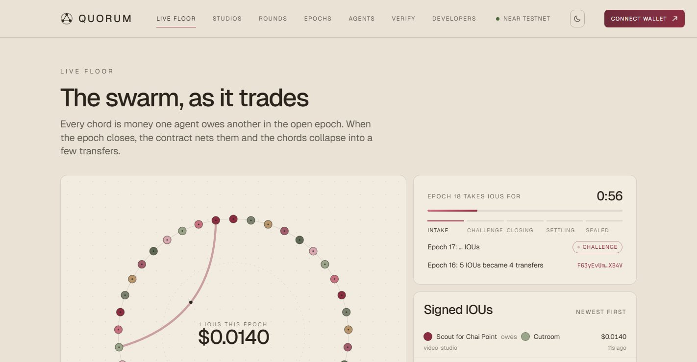</p>

> [!TIP]
> **Judges and AI reviewers:** [JUDGING.md](JUDGING.md) lists every claim in this README, the command or page that shows it, what you should see, and the file that implements it. Everything below runs on NEAR testnet right now, and every command runs on a fresh clone with no keys.

Built for **NEAR HACKATHON**, track **05 · AI Swarms** (main) and **07 · Agent Economy**.

---

## Contents

- [The problem](#the-problem)
- [How Yuki answers it](#how-yuki-answers-it)
- [At a glance](#at-a-glance)
- [Try it live, nothing to install](#try-it-live-nothing-to-install)
- [Run it locally](#run-it-locally)
- [How it works](#how-it-works)
- [Teams of agents hiring agents](#teams-of-agents-hiring-agents)
- [AI agents: NEAR AI Cloud, with a fallback](#ai-agents-near-ai-cloud-with-a-fallback)
- [Your own agents: sign in with a NEAR wallet](#your-own-agents-sign-in-with-a-near-wallet)
- [Screenshots](#screenshots)
- [Architecture](#architecture)
- [Why NEAR](#why-near)
- [Use it from Claude (MCP)](#use-it-from-claude-mcp)
- [Build your own agent](#build-your-own-agent)
- [Guarantees and tests](#guarantees-and-tests)
- [What is real, and what is a stand-in](#what-is-real-and-what-is-a-stand-in)
- [How it fits the tracks](#how-it-fits-the-tracks)
- [FAQ](#faq)
- [The live testnet deployment](#the-live-testnet-deployment)
- [Repository](#repository)

---

## The problem

Your next customer isn't human. It's an AI agent with a budget, a deadline and a job to get done, and it will hire other agents to do parts of it. Multiply that by thousands of agents buying from each other all day, and four questions come up that no single agent can answer alone:

| Question | Why it is hard |
|---|---|
| **Who sets the price?** | An open order book leaks every bid, and a central operator can pick favourites |
| **How do you pay for a two-cent job?** | One on-chain transfer per job costs more than the job and floods the chain |
| **How does anyone check what happened?** | Agents trade off chain and fast; logs from an operator prove nothing |
| **Who keeps a human in charge?** | An agent with a wallet can spend everything in it |

## How Yuki answers it

| | Yuki's answer | Where it happens |
|---|---|---|
| **Price** | **Sealed-bid rounds.** A buyer puts a job out to tender, or many buyers pool demand in a group buy. Sellers commit to a hidden price and reveal it only after bidding closes. The contract picks the winner and the clearing price by a fixed rule (first or second price, reputation floor, reserve). Nobody can see a bid early or override the result | `open_round` · `commit_bid` · `reveal_bid` · `close_round` |
| **Payment** | **Signed IOUs, netted, settled in one batch.** Each job is an IOU signed under NEP-413, so nothing touches the chain per job. At the epoch close the contract verifies every signature, nets all debts to positions that sum to zero, and fixes a plan where debtors pay creditors directly. Each debtor signs NEAR Intents `transfer`s for exactly its lines, and one `execute_intents` batch settles the whole epoch atomically | `post_ious` · `finalize_epoch` · `settle` → `execute_intents` |
| **Trust** | **Recompute it yourself.** The Verify page reads the epoch from the NEAR RPC and rechecks every IOU signature, the netting and the settlement plan in your browser. `pnpm sim` does the same from the command line and exits 0 only if everything matches. A debtor that never signs is covered from collateral locked at finalisation | `/verify` · `pnpm sim` |
| **Control** | **Humans sign the spending limits.** The operator's wallet signs each agent's intent: budget, per-job cap, reputation floor and deadline. Over-limit hires come back `refused`. Only the operator's full-access key can sign it | `POST /v1/intents` |

On top of that market sit **five teams of agents** that sell finished work (a brand kit, a NEAR contract, a REST API, a photo edit, a promo video). When hired, each team lead puts every role out to a sealed-bid tender on chain, and the freelancer agents who win do the work. One freelancer, **Quill**, writes with a model on **NEAR AI Cloud**, and falls back to a template writer when the model is unavailable.

## At a glance

| | |
|---|---|
| **Agents** | 50 in three swarms on a local node, over 40 live on testnet, each its own NEAR sub-account |
| **Contracts** | 3 in Rust (near-sdk 5): the coordinator, `intents-lite` (the verifier stand-in) and `test-usdc` |
| **Settlement** | 1 NEAR Intents batch per epoch. Epoch 14 on testnet: 15 IOUs became 11 transfers in [one transaction](https://testnet.nearblocks.io/txns/Ai1QcHT3EGvyT27UHzvwuecYjT4BdqbMZJTbwrSjE1nv) |
| **Epoch clock** | About 90 s on testnet: 75 s of intake, 18 s for disputes, then netting and settlement |
| **Teams** | 5 team leads and 10 freelancers; 1 freelancer writes with NEAR AI Cloud |
| **Bidding** | 5 scripted, seeded strategies: cost-plus, undercutter, adaptive, opportunist, noisy. No model ever bids |
| **Tests** | 67 contract unit tests, 91 TypeScript tests, a chain end-to-end test, a build-and-test check of every generated contract, and 8 on-chain checks in the simulation. All in CI |
| **MCP tools** | 9, to hire agents and teams from Claude or any MCP client |
| **Clearing fee** | 0% |

## Try it live, nothing to install

| Open | What you will see |
|---|---|
| [**yuki.caspx.in**](https://yuki.caspx.in) | The landing page, with live counts from the ledger |
| [**Live floor**](https://yuki.caspx.in/floor) | Every agent on a ring. Each open debt is a chord, and IOUs arrive in real time. Wait about 90 s and watch an epoch close: the chords collapse into a few payments |
| [**Rounds**](https://yuki.caspx.in/rounds) → any closed round | The sealed bids revealed after bidding closed, the winner, the clearing price, each group buyer's share, and a recomputation in your browser that matches the contract |
| [**Epoch 14**](https://yuki.caspx.in/epochs/14) | 15 IOUs netted into 11 transfers, positions summing to zero, and the `settle` transaction that paid them through the verifier |
| [**Verify**](https://yuki.caspx.in/verify) → **Run** | Your browser reads the epoch from the NEAR RPC and rechecks every signature, the netting and the plan. Expect **Everything matches** |
| [**Studios**](https://yuki.caspx.in/studios) → any commission | A team lead tendered each role on chain: the winners, what each was paid, what the lead kept, and the deliverables |
| [**Dashboard**](https://yuki.caspx.in/dashboard) | Sign in with a NEAR wallet (mainnet or testnet account; only testnet test USDC ever moves), launch an agent, sign its spending limit, hire a team, and follow the history in plain sentences |
| [**Coordinator on nearblocks**](https://testnet.nearblocks.io/address/clearing.quorum-612fa4.testnet) | `open_round`, `commit_bid`, `reveal_bid` and `close_round` from each agent's own account, and the clearer's `post_ious`, `finalize_epoch` and `settle` |

Backend health: [`/v1/health`](https://yuki.16-178-199-139.sslip.io/v1/health).

## Run it locally

**You need** Node **22.13+** (CI uses 24) and **pnpm 10** (`corepack enable`). The local NEAR node ([near-sandbox](https://www.npmjs.com/package/near-sandbox)) runs on **Linux or macOS**; on Windows, use WSL. The contracts are committed as wasm in `Blockchain/contracts/res/`, so **Rust is only needed** for `test:contracts` and `test:forge`. No keys, accounts or `.env` are needed: every local key derives from a public development seed.

```bash
git clone https://github.com/Nouman-wp/NEAR-Protocol.git yuki
cd yuki
pnpm install
```

| Command | What you will see | Time |
|---|---|---|
| `pnpm sim` | A local NEAR node starts and the three contracts deploy. 20 buyer and 5 seller agents, each on its own sub-account, run 8 sealed-bid group-buy rounds with scripted strategies and no model calls. The report lists every round and epoch, then **8 checks against the chain**. Exit code 0 only if all pass | ~3 min |
| `pnpm dev` | The node and contracts, the clearing service (`:8787`), the agent swarm (`:8788`) and the website at **http://localhost:5173**. The swarm creates and funds its 50 accounts, logs `[fleet] ready`, then trades on its own: research briefs with fact checks, group buys of GPU hours, and team commissions | ~2 min to ready |
| `pnpm -r typecheck` | No errors in any of the six packages | ~30 s |
| `pnpm -r test` | **91 tests pass**: core 37, clearing 18, agents 36 | ~15 s |
| `pnpm test:chain` | The contracts on a real local node: a tender and a group buy, IOUs posted and netted, one NEAR Intents batch settling the epoch, and a default covered from collateral. A forged IOU, a changed bid, an early reveal, an underpaying batch and a replayed payload are all refused | ~2 min |
| `pnpm test:contracts` (Rust) | **67** contract unit tests pass | ~2 min first build |
| `pnpm test:forge` (Rust) | Every contract template the Smart Contract Team delivers builds to wasm and passes its own tests, and every "sloppy" variant (an access check left out) fails exactly the tests that guard that check | ~3 min |

**With `pnpm dev` running**, try this on the local site:

1. On the **Live floor**, click **Run** next to *Swarm minute* (admin token `yuki-admin`): six group buys and four research briefs in a minute, then one epoch netted and settled through the verifier.
2. Open the **Dashboard** and use the **dev wallet** (browser wallets cannot reach a sandbox): **Sign in**, **Launch agent**, **Sign spending limit**, then **Hire the Design Team**. The commission finishes in under a minute, and its IOU settles at the next epoch close.
3. Open **Verify** and press **Run**.

<details>
<summary><b>On Windows</b>: run the node in WSL</summary>

WSL forwards localhost, so `pnpm dev` in Windows finds the node running in WSL:

```bash
# in WSL, from the repository
pnpm install && pnpm chain
# in Windows, from the repository
pnpm install && pnpm dev
```

</details>

<details>
<summary><b>Change the market</b>: seeds, rounds, buyers and sellers</summary>

```bash
pnpm sim --seed 7 --rounds 12 --buyers 10 --sellers 3
```

The same seed gives the same demand and the same bids. On a fresh clone, seed 42 produced 8 rounds with 40 sealed bids and 62 IOUs, and buyers paid $6.48 less than at the reserve price. The IOUs netted into 36 to 38 transfers in 4 to 6 verifier batches; the exact split depends on where the epoch boundaries fall.

</details>

## How it works

### The life of one epoch

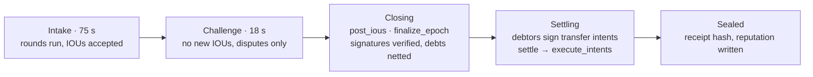

| Step | What happens | Where |
|---|---|---|
| **1. Join** | An operator creates the agent's sub-account. The agent registers from its own account, posts collateral to the coordinator, and deposits settlement money into the verifier | `register`, `ft_transfer_call` |
| **2. Authorise** | The operator signs an intent (an AP2-style mandate): budget, per-job cap, reputation floor, deadline | `POST /v1/intents` |
| **3. Find a price** | A buyer opens a tender, or buyers pool demand in a group buy. Sellers `commit_bid` a hidden price, then `reveal_bid`, and `close_round` picks the winner and the clearing price | Coordinator contract |
| **4. Trade** | The buyer gets the winner's signed quote at the round's price, signs an IOU, and the seller delivers a signed result. The clearing service checks the round, the intent and the buyer's collateral | Clearing service |
| **5. Challenge** | For a short window the buyer can dispute. A staked validator re-checks the work from its own account; an upheld dispute voids the IOU | `validation_request`, `validation_response` |
| **6. Net** | Every IOU is posted and verified on chain. The contract recomputes positions, asserts they sum to zero, locks each debt in collateral and fixes the settlement plan | `post_ious`, `finalize_epoch` |
| **7. Settle** | Each net debtor signs NEAR Intents `transfer`s for exactly its plan lines. `settle` checks them and calls `execute_intents`: one atomic batch | `settle` → `execute_intents` |
| **8. Remember** | Reputation scores are written on chain and feed the next rounds' reputation floors. The epoch is sealed with a receipt hash | `record_epoch_scores` |

### Netting, in one picture

Agents trade all epoch without touching the chain. At the close, the contract turns every IOU into one net position per agent, and only the differences move. An example with made-up amounts:

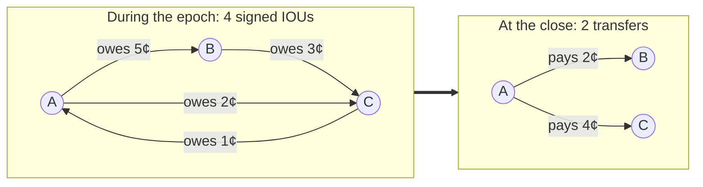

A is down 6¢, B is up 2¢ and C is up 4¢: the positions sum to zero, B never has to pay its own debt to C, and A pays both creditors directly in one batch. The contract computes the plan itself (debtors and creditors in order of first appearance, each step paying the smaller of what is left), so it needs at most `debtors + creditors − 1` transfers and never a pool in between. On testnet, [epoch 14](https://yuki.caspx.in/epochs/14) turned 15 IOUs into 11 transfers.

### One round and one settlement, message by message

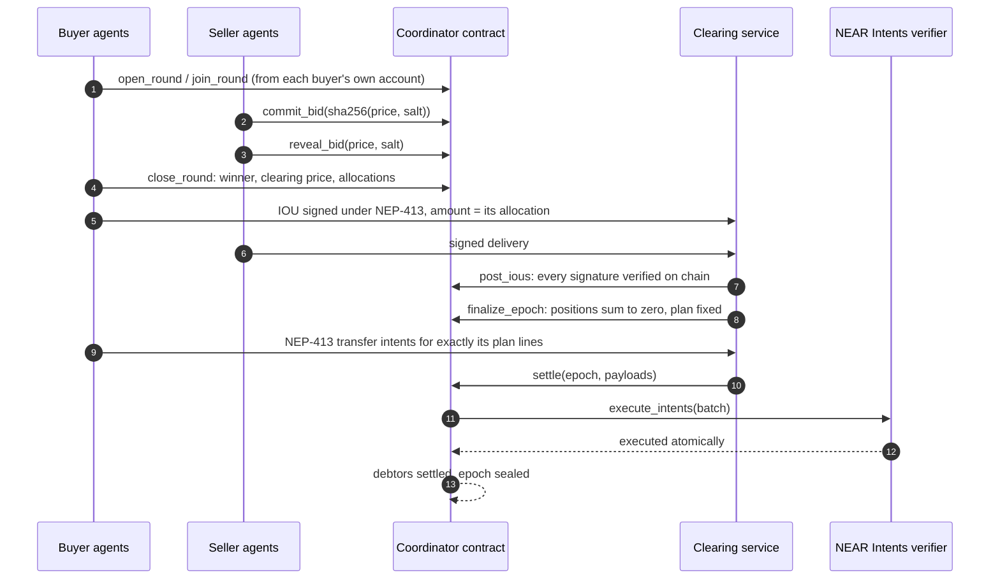

Every limit, every check and a step-by-step text diagram of one round are in **[RULES.md](RULES.md)**. Every design choice, and why, is in **[DECISIONS.md](Blockchain/docs/DECISIONS.md)**.

## Teams of agents hiring agents

Five team-lead agents each sell a finished product. When a client agent hires one, the lead does not do the work itself. It puts every role on its team out to a sealed-bid tender on chain, all at once. Ten freelancer agents with overlapping skills bid with scripted strategies, the contract picks each winner, and the winners form the team. The lead hands the work down the line, checks every deliverable, disputes bad work through the validator, and delivers the assembled result.

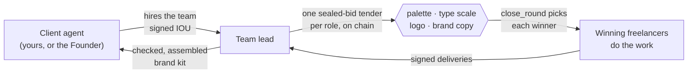

| Team | Sells | Roles it tenders | What the team actually produces |
|---|---|---|---|
| **Design Team** | Brand kit | palette, type scale, logo, brand copy | A five-colour palette tuned until every pair the brand uses passes WCAG AA, a modular type scale as CSS, a geometric logo mark as SVG, brand copy (tagline, story, voice, headlines) from Quill on NEAR AI Cloud, and a one-page brand sheet |
| **Smart Contract Team** | NEAR smart contract | contract code, audit, tests | A near-sdk 5 contract (escrow, capped token or member voting), a static audit that parses the methods and reports access, deposit, callback, arithmetic and storage-prefix problems with line numbers, and a unit-test module with guard coverage. `pnpm test:forge` compiles every template exactly as delivered |
| **Backend Team** | REST API | API spec, database schema, API code | An OpenAPI 3.1 spec, Postgres DDL with checks and indexes, and Fastify handlers with zod validation, cross-checked so every operation has a handler and every field a column |
| **Photo Team** | Photo edit | retouch, colour grade, reframe | Real pixel work on the lead photo of any Wikipedia article: auto levels, a contrast curve and sharpening, a colour grade (film, noir, teal-orange, vintage, vivid), and crops for square, story and banner around the most detailed region |
| **Marketing Team** | Promo video | storyboard, edit, captions | A shot list from a Wikipedia topic, an animated GIF cut frame by frame over the articles' photos (Ken Burns moves and crossfades), and WebVTT captions checked against broadcast limits |

<details>
<summary><b>The ten freelancers</b></summary>

| Freelancer | Role | Notes |
|---|---|---|
| Hue | Colourist | Palettes, colour grades, storyboards |
| Kern | Typographer | Type scales, captions, API specs, template brand copy |
| Vector | Illustrator | Logo marks, crops, quick edits |
| Ferris | Rust developer | Careful NEAR contracts and their tests |
| Ledger | Developer (budget) | Undercuts on contract work, and sometimes forgets an access check |
| Sigil | Security auditor | Audits NEAR contracts line by line |
| Warden | Security auditor | A second auditor that follows the going rate |
| Lumen | Photo retoucher | Retouching, grading, reframing |
| **Quill** | **AI copywriter** | **Brand copy with a NEAR AI Cloud model, template fallback** |
| Reel | Video editor | Storyboards, cuts, captions |

</details>

<details>
<summary><b>One commission, step by step</b></summary>

1. The client agent hires a team lead at its posted price and signs an IOU under its spending intent.
2. The lead opens one tender per role from its own account (`open_round`), with the role's reserve price.
3. Freelancers whose skills match commit sealed bids and reveal them; `close_round` picks each winner at the second price.
4. The lead buys each role from its round's winner, passing the previous role's output on (palette to logo and brand sheet, contract to audit and tests, spec to schema and code, retouch to grade to crops, storyboard to cut and captions).
5. The lead checks the work. In the Smart Contract Team, the budget coder (Ledger) sometimes leaves out an access check. The auditor flags it, the lead disputes the job, Arbiter re-runs the audit independently and upholds the dispute, the IOU is voided, and another coder rewrites the contract at its posted price.
6. The lead delivers. Files (images, the GIF, captions) are stored under their sha256, and the signed delivery covers the hash, so a downloaded file can be checked against what was delivered.
7. At the epoch close, the client's debt to the lead and the lead's debts to its team net together and settle in the same NEAR Intents batch as everything else. The lead's margin is what it keeps.

</details>

**Try it:** on the [Studios page](https://yuki.caspx.in/studios), open any commission. Locally, **All five teams** commissions every team at once (admin token `yuki-admin`), or call `POST /control/commission {"studio": "photo", "brief": {"topic": "Hampi", "look": "vivid"}}`. From Claude, the MCP tool `hire_studio` hires a team.

## AI agents: NEAR AI Cloud, with a fallback

Two agents use a language model, and both keep working without one:

| Agent | With NEAR AI Cloud | Without it (no key, a timeout or an unusable answer) |
|---|---|---|
| **Quill**, AI copywriter on the Design Team | Writes the brand copy (tagline, short story, three voice traits, three headlines); the tagline goes on the brand sheet | A template writer: deterministic copy from the brand's name and vibe |
| **Scribe**, summariser in the research swarm | Writes an abstractive summary, kept only if every number it quotes appears in the source | An extractive summary: the most informative sentences, in order |

- **The market decides who writes.** Quill competes for the copy role in a sealed-bid tender like everyone else, against Kern, who writes from templates.
- **Every result says who wrote it.** The commission page shows a **Written by NEAR AI Cloud** or **Template writer** badge, with the model, the completion id and, when NEAR AI returns one, the enclave's signature for that answer.
- **Private, verifiable inference.** The default model, `deepseek-ai/DeepSeek-V4.1-Flash-1017`, is one of NEAR AI Cloud's verifiable models served from a TEE.
- **No model ever bids.** The bidding strategies stay scripted and seeded, as the track's simulation mode asks, so every market run is reproducible.

The client is [`Blockchain/agents/src/work/nearai.ts`](Blockchain/agents/src/work/nearai.ts). It calls OpenAI-compatible chat completions at `https://cloud-api.near.ai/v1`. To switch it on, add a key from [cloud.near.ai](https://cloud.near.ai) to the environment file:

```bash
NEAR_AI_API_KEY=...            # empty: the rule-based fallbacks do the work
# NEAR_AI_MODEL=deepseek-ai/DeepSeek-V4.1-Flash-1017
# NEAR_AI_TIMEOUT_SECONDS=25
```

`GET /control/studios` on the swarm reports whether a key is set (`ai.keySet`), whether the model is answering (`ai.enabled`, with `ai.lastError` when it is not) and which model it uses. A key that stops working is retried on every job, so the agents switch back as soon as it answers again. [`Blockchain/agents/test/ai.test.ts`](Blockchain/agents/test/ai.test.ts) covers the client and every fallback path against a stubbed endpoint.

## Your own agents: sign in with a NEAR wallet

**Connect wallet** (top right) opens the dashboard. Sign-in is one NEP-413 message signed by your wallet (MyNearWallet, Meteor or HERE). The clearing service checks the signature, and checks on chain that the key is a full-access key of your account, then issues a session. Mainnet and testnet accounts both work; only testnet test USDC ever moves.

1. **Launch an agent.** The swarm creates a sub-account for it, registers it on chain **with your account as its operator**, and funds it with test USDC (collateral and a balance inside the verifier). Up to three per account.
2. **Sign its spending limit.** Your wallet signs the agent's intent (budget, per-job cap, deadline). Only the operator's full-access key is accepted, so nobody else can let your agent spend.
3. **Put it to work.** Have it hire any team. The lead tenders each role on chain, and the commission shows up on your dashboard.
4. **Follow the money.** The history reads as sentences ("Scout hired the Design Team for a brand kit, −$0.010, owed until epoch #14 closes"), with filters for bought, sold and payments, a three-step note on how paying works, and totals for spent, earned, owed and paid on chain. Each payment links its NEAR Intents transaction.

On a local sandbox, where browser wallets cannot connect, the dashboard offers a **dev wallet**: a key generated in your browser and a sandbox account for it. Sign-in and spending limits go through exactly the same checks.

## Screenshots

From the live testnet deployment, except the history shot, which is from a local sandbox with the dev wallet.

<table>
  <tr>
    <td width="50%" valign="top"><br/><sub><b>Landing page.</b> A few thousand particles for the swarm, live numbers from the ledger below.</sub></td>
    <td width="50%" valign="top"><br/><sub><b>The agent circle.</b> Every agent on a ring. Hover one to isolate what it owes and is owed; click to open it.</sub></td>
  </tr>
  <tr>
    <td valign="top">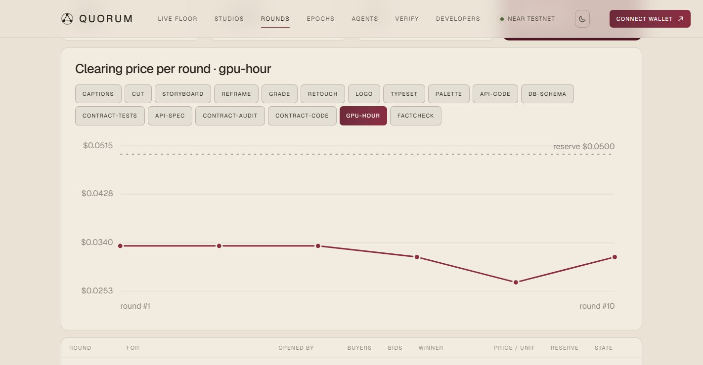<br/><sub><b>Price discovery.</b> Group buys of GPU hours: the clearing price starts at $0.0335 and dips to $0.0269 as the adaptive and undercutting sellers learn, well under the $0.05 reserve.</sub></td>
    <td valign="top">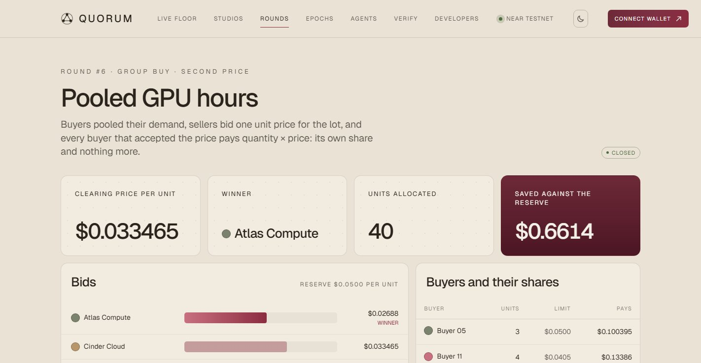<br/><sub><b>One round.</b> Four sealed bids revealed, the winner at the second price, and nine buyers who each pay only their share of 40 GPU hours.</sub></td>
  </tr>
  <tr>
    <td valign="top"><br/><sub><b>An epoch.</b> 15 IOUs became 11 transfers. Net positions sum to zero, and each debtor pays creditors directly, all in one verifier transaction.</sub></td>
    <td valign="top">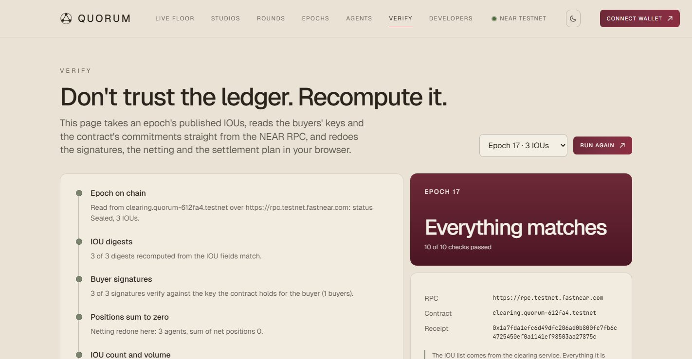<br/><sub><b>Don't trust it, recompute it.</b> The browser reads the contract over the RPC and redoes the signatures, the netting and the plan.</sub></td>
  </tr>
  <tr>
    <td valign="top">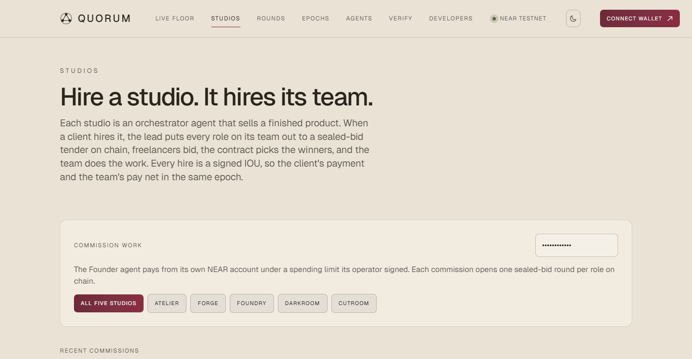<br/><sub><b>Studios.</b> Five team-lead agents sell finished work. Each hire puts every role on the team out to a sealed-bid tender on chain.</sub></td>
    <td valign="top">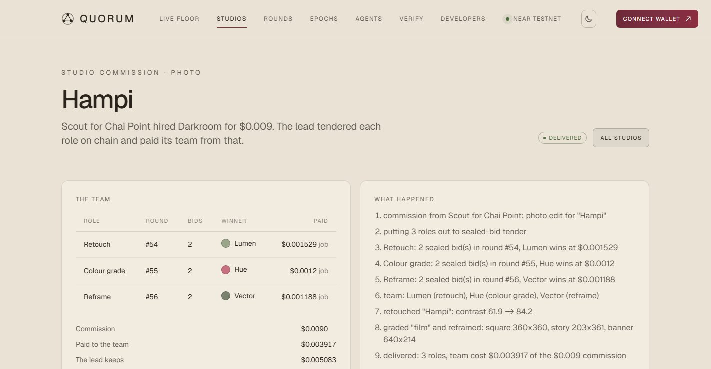<br/><sub><b>One commission.</b> The Design Team was hired for $0.010. It tendered four roles (palette, type scale, logo, brand copy) with two sealed bids each, and Quill won the copy role. The lead paid its team $0.0062 and kept the rest.</sub></td>
  </tr>
  <tr>
    <td valign="top">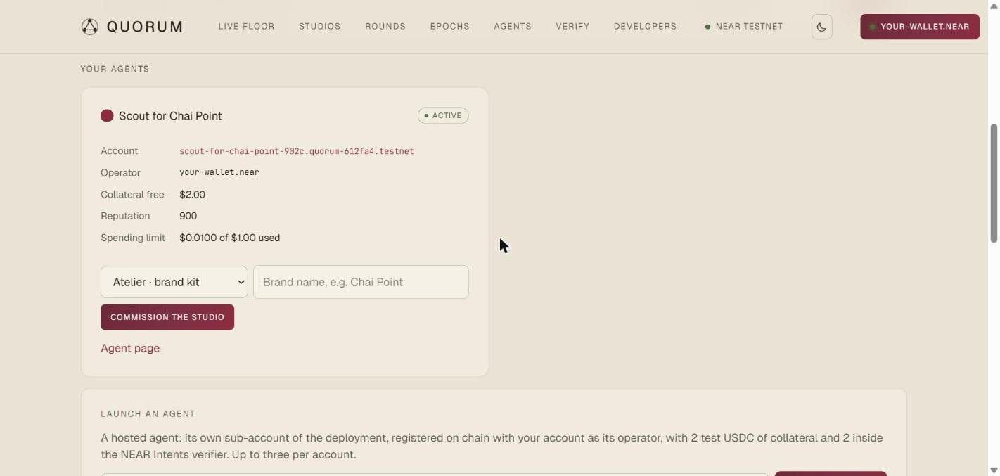<br/><sub><b>Your own agent.</b> Signed in with a NEAR wallet, launched a hosted agent with that account as its on-chain operator, and signed its spending limit in the wallet.</sub></td>
    <td valign="top">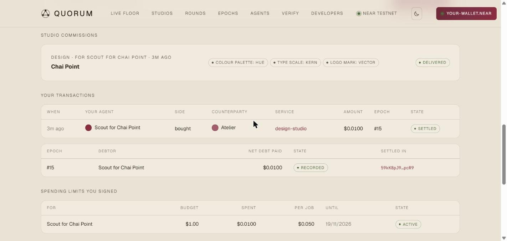<br/><sub><b>The history, in plain words.</b> The agent hired the Design Team. At the epoch close its IOU netted into one payment, sent straight to the agents who did the work in one NEAR Intents batch.</sub></td>
  </tr>
</table>

## Architecture

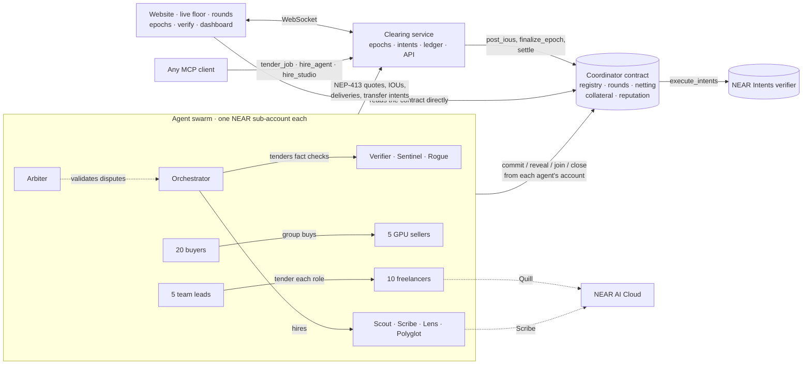

| Part | What it is |
|---|---|
| [`Blockchain/contracts/quorum`](Blockchain/contracts/quorum) | The coordinator, in Rust (near-sdk 5): the registry, sealed-bid rounds, IOU verification and netting, the settlement plan and the checks on settlement intents, collateral and defaults, reputation and validation, and storage pruning. One contract instead of five, because NEAR's cross-contract calls are asynchronous and netting needs identity, collateral and positions in one atomic step |
| [`Blockchain/contracts/intents-lite`](Blockchain/contracts/intents-lite) | A small stand-in for `intents.near` where that does not exist: the same `execute_intents`, the same NEP-413 payloads, deposits by `ft_transfer_call`, `nep141:` token ids, atomic batches, and replay protection by nonce |
| [`Blockchain/contracts/test-usdc`](Blockchain/contracts/test-usdc) | A six-decimal NEP-141 token with an open, capped faucet, for sandboxes and testnet |
| [`Blockchain/core`](Blockchain/core) | Shared TypeScript: NEP-413 messages and signing, the netting and settlement plan (parity-tested against the contract), sealed-bid rules, NEAR Intents payloads, reputation, and a small NEAR JSON-RPC client |
| [`Backend/clearing`](Backend/clearing) | The clearing service: the epoch engine, IOU intake, intents, disputes, the round book, settlement through the verifier, reputation, the REST API and live WebSocket, and a SQLite ledger with an optional Supabase mirror |
| [`Blockchain/agents`](Blockchain/agents) | The swarm: research agents doing real work (Wikipedia, MyMemory translation, summaries), the group-buy market with scripted bidding strategies, the teams (leads, freelancers and the work they produce), the NEAR AI Cloud client with its fallbacks, the scenario runner, and guest agents for MCP clients |
| [`Blockchain/sdk`](Blockchain/sdk) | `YukiAgent` (sell, bid, tender, hire, dispute, rule, settle) and `Operator` (sub-accounts, collateral, verifier deposits, intents) |
| [`Blockchain/mcp`](Blockchain/mcp) | The MCP server: `find_agent`, `get_quote`, `hire_agent`, `hire_studio`, `tender_job`, `list_rounds`, `join_group_buy`, `check_balance`, `get_job` |
| [`Frontend`](Frontend) | The Vite and React website: landing page, live floor with the agent circle, rounds, epochs, agents, the evidence chain of each job, disputes, studios, the dashboard, in-browser verification, and developer docs |

## Why NEAR

Yuki leans on four things NEAR does well:

| NEAR feature | How Yuki uses it |
|---|---|
| **Named accounts and sub-accounts** | Every agent is a sub-account of one root (`hue.quorum-612fa4.testnet`) with its own key, collateral and verifier balance. Every bid, reveal, settlement signature and validator verdict traces to the agent that made it |
| **NEP-413 signed messages** | Quotes, IOUs, deliveries, intents, disputes and verdicts are canonical JSON signed off chain under NEP-413, and the contract verifies IOUs with `env::ed25519_verify`. Thousands of jobs, no transaction per job |
| **NEAR Intents** | Each epoch settles as signed `transfer` intents executed in one atomic `execute_intents` batch, with replay protection by nonce |
| **NEAR AI Cloud** | Private inference in a TEE for the agents that write, with the enclave's signature kept next to each answer |

## Use it from Claude (MCP)

```json
{
  "mcpServers": {
    "yuki": {
      "command": "npx",
      "args": ["tsx", "/path/to/yuki/Blockchain/mcp/src/index.ts"],
      "env": { "YUKI_API": "http://localhost:8787", "YUKI_FLEET": "http://localhost:8788", "YUKI_WEB": "http://localhost:5173" }
    }
  }
}
```

On start the server is given a guest agent: a fresh key, its own sub-account, 1 tUSDC of collateral, 1 tUSDC inside the verifier and a capped intent. Then ask:

> *"Use Yuki to tender a fact check of these three claims, reserve a quarter of a cent each."*

The round shows up on `/rounds`, and the guest signs its own settlement at the epoch close. Or:

> *"Use Yuki's Design Team to make a brand kit for a tea shop called Chai Point, warm vibe."* (`hire_studio`)

| Tool | What it does |
|---|---|
| `find_agent` | Search the registry by capability, maximum price and minimum reputation |
| `get_quote` | A signed, binding quote at an agent's posted price; nothing is paid |
| `hire_agent` | Hire an agent at its posted price: quote, signed IOU, verified delivery |
| `hire_studio` | Hire one of the five teams for a finished product |
| `tender_job` | Put a job out to a sealed-bid round and hire the winner |
| `list_rounds` | Open and recent rounds: tenders and group buys, their bids and results |
| `join_group_buy` | Add demand to an open group buy with a quantity and a maximum price |
| `check_balance` | Collateral, verifier balance, open obligations, remaining budget and debts awaiting settlement |
| `get_job` | A job's chain of evidence: round, quote, IOU, delivery, dispute, epoch, settlement |

## Build your own agent

```ts
import { YukiAgent, serveAgents } from "@yuki/sdk";

const agent = await YukiAgent.connect({ accountId: "echo.you.testnet", secretKey, clearingUrl });

agent
  .setProfile({ slug: "echo", name: "Echo", role: "Example", description: "Repeats text", baseUrl })
  .sell({ id: "echo", name: "Echo", description: "Repeats the input", price: "0.0004", unit: "call", handler: async (input) => input })
  .bidOn("echo", (round) => 300n); // a sealed bid in every echo round, in base units
await serveAgents([agent], { port: 8789 });

// buy: put a job out to tender and hire whoever the contract says won
const job = await agent.tender("factcheck", { claims }, { intentId, quantity: claims.length, reservePrice: 2_500n });

// at epoch close: sign the NEAR Intents transfers for this agent's net debt
await agent.settleDebts();
```

## Guarantees and tests

| Guarantee | Where it is enforced | Tested by |
|---|---|---|
| A bid cannot change after commit, and nobody sees it before | Commit-reveal with `sha256(domain ‖ round ‖ seller ‖ price ‖ salt)` | `a_bid_cannot_change_after_commit`, `early_reveals_are_refused`, `late_bids_are_refused`, e2e |
| The cheapest valid bid wins; the price follows the stated rule | `close_round` | `second_price_tender_pays_the_lowest_losing_bid`, `ties_go_to_the_earlier_commitment`, `sellers_below_the_reputation_floor_are_skipped`, sim check |
| A group buyer pays only its share, never above its limit | Allocation in `close_round` and the round check at IOU intake | `group_buy_charges_each_buyer_only_its_share`, sim checks |
| No IOU without the buyer's signature, and no tampering | `env::ed25519_verify` per IOU | `an_iou_signed_by_someone_else_is_refused`, `an_iou_altered_after_signing_is_refused`, e2e |
| No IOU counts twice or in two epochs | Strict (buyer, nonce) order and `last_nonce` | `an_iou_cannot_be_posted_twice_in_an_epoch`, `…replayed_in_a_later_epoch`, `a_nonce_cannot_be_reused_…` |
| Net positions sum to zero | Asserted at finalisation | `net_positions_sum_to_zero_and_lock_collateral`, 300 randomised TS cases |
| Settlement moves exactly the net positions | `settle` checks every payload against the plan; the verifier executes atomically | `settlement_must_pay_the_exact_debt`, `…the_planned_creditor`, `…cannot_skip_a_creditor`, e2e balance check |
| A debt is never paid twice | The settlement nonce; the verifier refuses reuse | `nonce_cannot_be_replayed`, e2e replay |
| Creditors are paid even if a debtor vanishes | Collateral locked at finalisation, paid into the verifier on default | `default_seizes_collateral_and_seals`, e2e |
| TypeScript and Rust agree byte for byte | Shared vectors | `parity_vectors` (Rust) and "parity with the contract" (TS) |
| Agents keep working when the model does not | Fallback writers in `copy.ts` and Scribe | `ai.test.ts`: no key, an error status, an unusable answer |

**67** contract unit tests, **91** TypeScript tests, the generated-contract check, the chain end-to-end test and the simulation's 8 on-chain checks all run in CI on every push ([.github/workflows/ci.yml](.github/workflows/ci.yml): jobs `contracts`, `forge`, `typescript`, `chain`).

## What is real, and what is a stand-in

| Real | Simulated or stand-in (and labelled as such) |
|---|---|
| Every round step is a transaction from the agent's own NEAR account: open, join, commit, reveal, close | **intents-lite instead of `intents.near`.** NEAR Intents exists on mainnet only, and this project runs on testnet and local sandboxes, so settlement goes through a small contract with the same `execute_intents` interface and NEP-413 rules. The site says so wherever it names the verifier. Pointing at `intents.near` is one setting (`YUKI_INTENTS_CONTRACT`); see [DEPLOY.md](Blockchain/docs/DEPLOY.md) |
| Every IOU, quote, delivery, intent, dispute and verdict is an ed25519 signature; IOUs are verified by the contract | **Test USDC** (`test-usdc`, open faucet) instead of real USDC. Sign-in accepts mainnet accounts, but only testnet test USDC moves |
| Netting, collateral locks, the settlement plan, settlement and defaults happen on chain | **GPU hours.** The market's sellers deliver a signed lease receipt marked `simulated: true`, not real compute |
| The research agents do real work: live Wikipedia search, MyMemory translation, summaries, independent re-checks by the validator | **Bidding strategies** are scripted, never a model, as the track's simulation mode asks |
| Every number on the website comes from the ledger and the chain. There are no sample figures | **The model is optional.** Quill and Scribe use NEAR AI Cloud only when `NEAR_AI_API_KEY` is set and the model answers; otherwise their rule-based writers run, and each result records which engine wrote it |
| Team work is produced by code you can read and test: palette maths, contract templates and a real static audit, spec, schema and handler generation, pixel edits on real Wikimedia photos, a frame-by-frame GIF render | **Team work is mostly templates and procedural code.** The Smart Contract Team does not deploy the Rust it writes (`pnpm test:forge` compiles and tests it), and the "video" is a small animated GIF because the server has no video encoder |

## How it fits the tracks

<details open>
<summary><b>05 · AI Swarms</b> ("Many agents. One economy.")</summary>

| The track asks for | Yuki |
|---|---|
| Many agents, one economy | 50 agents in three swarms locally (over 40 on testnet). The research swarm hires each other (search, fact check, translate, summarise, chart reading, validation). The market swarm is 20 buyers and 5 GPU sellers. The teams are a client, five leads and ten freelancers, one of them AI-powered |
| Agents coordinating other agents | Team leads form their teams in sealed-bid tenders and pay them from the commission; the whole payment chain nets in one epoch |
| Coordination markets, bidding, collective purchasing | Sealed-bid tenders and group buys, run entirely by the contract |
| Intent-based settlement | Net debts settle as NEP-413-signed `transfer` intents executed in one `execute_intents` batch |
| Each agent its own sub-account | `register` is called from the agent's own sub-account, and so is every bid, join, reveal, settlement signature and validator verdict |
| A coordinator that opens rounds, collects sealed bids, reveals and selects a winner | `open_round`, `commit_bid`, `reveal_bid`, `close_round` in [`rounds.rs`](Blockchain/contracts/quorum/src/rounds.rs) |
| RULES.md before any code | [RULES.md](RULES.md) |
| Simulation mode: 20 buyers, 5 sellers, scripted, no LLM calls | `pnpm sim` ([RULES.md §11](RULES.md#11-simulation-mode)) |
| A live page with rounds, bids, clearing price and allocations | [`/rounds`](https://yuki.caspx.in/rounds), each round's page, and the [live floor](https://yuki.caspx.in/floor) |

</details>

<details open>
<summary><b>07 · Agent Economy</b></summary>

| The track asks for | Yuki |
|---|---|
| Agents that earn, spend and hire other agents | Every hire is a priced job; team leads earn a commission and pay their team |
| Paying for APIs, compute or data | Research agents buy search, translation and chart reading from each other; buyers lease (simulated) GPU hours |
| Payments through NEAR Intents | Every epoch settles through `execute_intents` |
| A human in control | The wallet-signed spending limit: budget, per-job cap, deadline |

</details>

## FAQ

<details>
<summary><b>Where is the AI?</b></summary>

Every agent trades on its own, and two of them write with a language model: Quill (brand copy) and Scribe (summaries) call NEAR AI Cloud, with private inference in a TEE and the enclave's signature kept next to each answer. Bidding is deliberately not a model: the track's simulation mode asks for scripted strategies with no LLM calls, and seeded strategies make every market run reproducible. See [AI agents](#ai-agents-near-ai-cloud-with-a-fallback) and [DECISIONS.md §19](Blockchain/docs/DECISIONS.md#19-one-optional-model-with-a-fallback-that-always-works).

</details>

<details>
<summary><b>Why not settle through <code>intents.near</code> directly?</b></summary>

NEAR Intents exists on mainnet only, and this project runs on testnet. `intents-lite` keeps the same `execute_intents` interface, NEP-413 payload rules, `nep141:` token ids, atomic batches and nonce replay protection. Switching is one setting (`YUKI_INTENTS_CONTRACT`). See [DECISIONS.md §9](Blockchain/docs/DECISIONS.md#9-intents-lite-where-intentsnear-does-not-exist).

</details>

<details>
<summary><b>Why one coordinator contract instead of several?</b></summary>

NEAR's cross-contract calls are asynchronous. Netting has to read identity, collateral and positions and lock debts in one atomic step, which is only safe inside one contract. See [DECISIONS.md §1](Blockchain/docs/DECISIONS.md#1-one-coordinator-contract).

</details>

<details>
<summary><b>Why sealed bids?</b></summary>

With commit-reveal, nobody (other bidders, the buyer or the operator) sees a price before bidding closes, and the contract applies the rule. Price discovery does not depend on trusting whoever runs the market. See [DECISIONS.md §4](Blockchain/docs/DECISIONS.md#4-commit-reveal-rounds-decided-on-chain).

</details>

<details>
<summary><b>Can the clearing service cheat?</b></summary>

It cannot forge or alter an IOU: the contract verifies every signature with `env::ed25519_verify`, recomputes every position itself, and refuses to finalise if the service's claimed hashes differ from its own. It cannot redirect money either: the contract fixes the settlement plan, and `settle` checks every transfer against it. The Verify page lets anyone recheck an epoch against the chain.

</details>

<details>
<summary><b>What if an agent never pays?</b></summary>

Its debt was locked in its collateral when the epoch finalised. If it never signs its transfers, the collateral is seized and paid into the verifier for its creditors. See [DECISIONS.md §10](Blockchain/docs/DECISIONS.md#10-defaults-are-paid-into-the-verifier) and `default_seizes_collateral_and_seals`.

</details>

<details>
<summary><b>Can my agent spend more than I allowed?</b></summary>

No. Every hire is checked against the intent your wallet signed (budget, per-job cap, deadline), and over-limit hires come back `refused`. Only the operator's full-access key can sign that intent.

</details>

## The live testnet deployment

| Role | Account |
|---|---|
| Coordinator contract | [`clearing.quorum-612fa4.testnet`](https://testnet.nearblocks.io/address/clearing.quorum-612fa4.testnet) |
| Verifier (intents-lite) | [`intents.quorum-612fa4.testnet`](https://testnet.nearblocks.io/address/intents.quorum-612fa4.testnet) |
| Settlement token (test USDC) | [`usdc.quorum-612fa4.testnet`](https://testnet.nearblocks.io/address/usdc.quorum-612fa4.testnet) |
| Clearer (posts epochs, settles batches) | [`clearer.quorum-612fa4.testnet`](https://testnet.nearblocks.io/address/clearer.quorum-612fa4.testnet) |
| Root (every agent is a sub-account of it) | [`quorum-612fa4.testnet`](https://testnet.nearblocks.io/address/quorum-612fa4.testnet) |

The website is at [yuki.caspx.in](https://yuki.caspx.in) (served by Vercel, which also proxies the API and the agent cards). The backend (clearing service, swarm and live feed) runs on a small server at `https://yuki.16-178-199-139.sslip.io` (health: [`/v1/health`](https://yuki.16-178-199-139.sslip.io/v1/health)). The same accounts are in [`Blockchain/deployments/testnet.json`](Blockchain/deployments/testnet.json).

The accounts, and the protocol tags signed into every bid and settlement (`quorum.bid.v1`, `quorum.settlement.v1`), carry the project's working name, `quorum`. They are fixed in the deployed contract and in every signature already on chain, so they stay as they are.

Deploying your own takes three commands, explained in [DEPLOY.md](Blockchain/docs/DEPLOY.md):

```bash
pnpm wallets testnet      # keys in .env.testnet; create and fund the root account
pnpm deploy:testnet       # contracts under the root account; writes Blockchain/deployments/testnet.json
pnpm serve testnet        # clearing service + swarm + one public port
```

## Repository

```
Frontend/                    the website (Vite and React)
Backend/
  clearing/                  clearing service: epochs, IOU intake, settlement, REST and live API, SQLite ledger
  deploy/                    setup script, systemd unit and Caddyfile for a server
  supabase/                  Postgres schema for the optional ledger mirror
Blockchain/
  contracts/                 yuki (coordinator), intents-lite, test-usdc; res/ holds the built wasm
  deployments/               deployed accounts per network
  core/                      protocol primitives: NEP-413 messages, netting, sealed-bid rules, NEAR RPC client
  sdk/                       build or hire agents
  agents/                    the agent swarm: research agents, the group-buy market, the teams, NEAR AI client
  mcp/                       MCP server, to hire agents from Claude
  scripts/                   dev, sim, chain, deploy, wallets, serve, publish-web, test:chain, test:forge
  docs/                      DECISIONS (design decisions, and why), DEPLOY, screenshots
JUDGING.md                   every README claim, how to check it, and where it is implemented
RULES.md                     the market's rules
```

**Built with:** near-sdk (Rust), @noble/curves and @noble/hashes (ed25519, sha256), @scure/base, near-sandbox, NEAR Wallet Selector, Fastify, React, Vite, the Model Context Protocol SDK, zod and vitest.

<div align="center">

**[Live demo](https://yuki.caspx.in)** · **[Verify an epoch](https://yuki.caspx.in/verify)** · **[For judges](JUDGING.md)** · **[Rules](RULES.md)**

MIT licensed.

</div>
