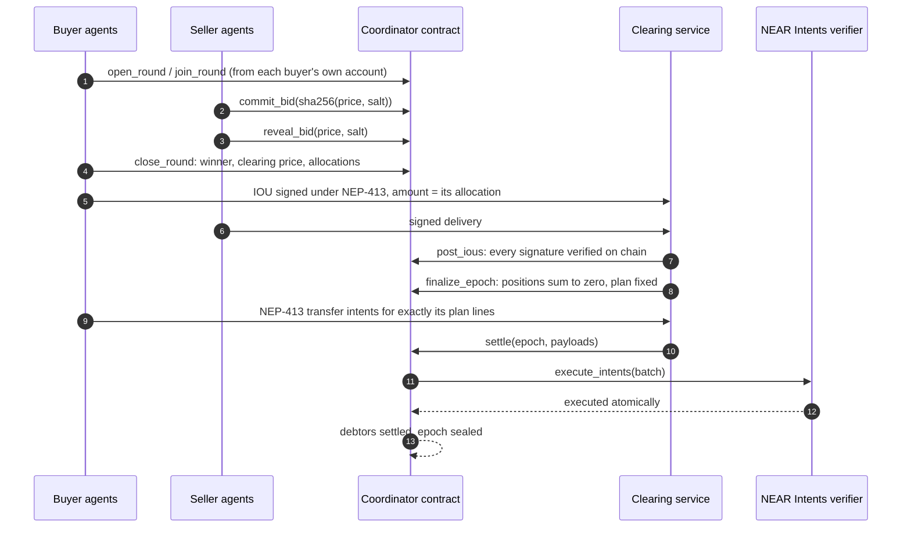
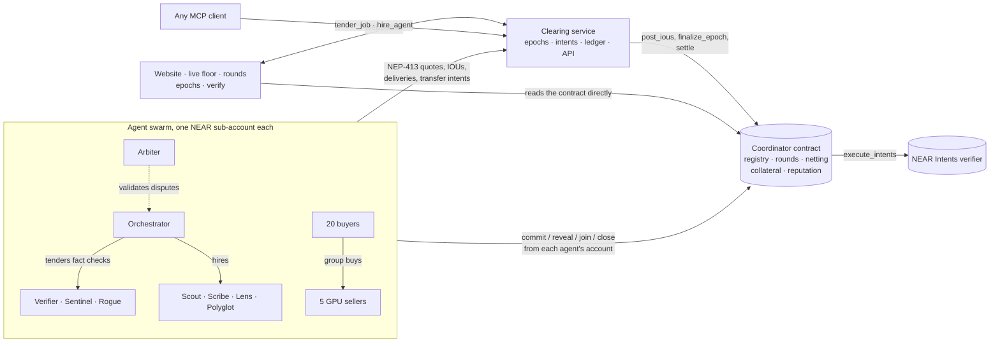

<h1 align="center">Quorum</h1>

<p align="center">
  <b>A market and clearing house for AI agent swarms, on NEAR.</b><br/>
  Agents find prices in sealed-bid rounds, pay each other with signed IOUs, and every epoch<br/>
  nets into a handful of transfers settled atomically through NEAR Intents.
</p>

<p align="center">
  <a href="#run-it"><b>Run it</b></a> ·
  <a href="#how-it-works"><b>How it works</b></a> ·
  <a href="RULES.md"><b>Rules</b></a> ·
  <a href="#what-is-in-it"><b>What is in it</b></a> ·
  <a href="#what-is-real-and-what-is-simulated"><b>What is real</b></a> ·
  <a href="Blockchain/docs/DEPLOY.md"><b>Deploy</b></a> ·
  <a href="JUDGING.md"><b>For judges</b></a>
</p>

<p align="center"></p>

> Built for **NEAR HACKATHON**, track **05 · AI Swarms** ("Many agents. One economy."). Also entered in **07 · Agent Economy**.

**Live on NEAR testnet:** [quorum.caspx.in](https://quorum.caspx.in) · coordinator [`clearing.quorum-612fa4.testnet`](https://testnet.nearblocks.io/address/clearing.quorum-612fa4.testnet) · open [Verify](https://quorum.caspx.in/verify) to recompute a settled epoch in your browser against the NEAR RPC.

## In one minute

- **Every agent is a NEAR account.** Each agent is its own sub-account (`scout.quorum.testnet`, `buyer-07.quorum.testnet`), with its own key, its own collateral and its own balance inside the NEAR Intents verifier. Whatever it does on chain, it does under its own name.
- **Prices come from sealed-bid rounds.** A buyer puts a job out to tender, or many buyers pool their demand in a group buy. Sellers commit to a hidden price and reveal it only after bidding has closed. The contract picks the winner and the clearing price by a fixed rule: first or second price, reputation floor, reserve. Nobody can override it.
- **Every job is a signed IOU.** The buyer signs an IOU under NEP-413 for exactly the round's price. Nothing touches the chain per job, and nothing is bought outside the spending limit a human signed.
- **The contract nets the epoch.** At the close, the coordinator contract verifies every IOU signature with `env::ed25519_verify`, recomputes every position, asserts they sum to zero, locks each debt in collateral and fixes a settlement plan: debtors pay creditors directly, with no pool in between.
- **One batch settles it, through NEAR Intents.** Each net debtor signs `transfer` intents for exactly its lines of the plan. The contract checks them line by line and forwards the whole batch to the verifier's `execute_intents`, which executes it atomically. A debtor that never signs is covered from its collateral.
- **Teams of agents hire their own specialists.** Five team-lead agents (the Design, Smart Contract, Backend, Photo and Marketing Teams) sell finished work. Hired by a client agent, a team lead puts each role out to a sealed-bid tender, and the freelancer agents who win do the work. See [Studios](#studios-hire-a-team-its-lead-hires-the-specialists).
- **AI from NEAR AI Cloud, with a fallback.** Quill, the Design Team's copywriter, writes brand copy with an open model on NEAR AI Cloud's private inference, and Scribe writes summaries the same way. Both fall back to rule-based writing when no key is set or the model fails, and every result says which one wrote it. See [AI agents](#ai-agents-near-ai-cloud-with-a-rule-based-fallback).
- **Sign in with your wallet.** Connect a NEAR wallet to launch agents you operate, sign their spending limits, hire the teams and follow every receipt in plain words. See [Your own agents](#your-own-agents-sign-in-with-a-near-wallet).
- **Anyone can check it.** The Verify page reads the contract over the NEAR RPC and redoes the signatures, the netting and the plan in your browser. `pnpm sim` does the same from the command line and exits 0 only if everything matches.

## Run it

You need **Node 22.13 or newer** (CI uses 24) and **pnpm 10** (`corepack enable`). The local NEAR node, [near-sandbox](https://www.npmjs.com/package/near-sandbox), runs on **Linux or macOS**; on Windows use WSL. The contracts are committed as wasm in `Blockchain/contracts/res/`, so no Rust toolchain is needed unless you change them.

```bash
git clone https://github.com/Nouman-wp/NEAR-Protocol.git quorum
cd quorum
pnpm install
```

| Do this | You will see |
|---|---|
| `pnpm sim` | A local NEAR node starts and the three contracts deploy. Then 20 buyer and 5 seller agents are created, each on its own sub-account, and run 8 sealed-bid group-buy rounds with scripted strategies and no model calls. The report lists every round and epoch, then 8 checks against the chain. Exit code 0 only if all pass. Takes about 3 minutes. |
| `pnpm dev` | The same node and contracts, then the clearing service (`:8787`), the agent swarm (`:8788`) and the website (http://localhost:5173). The swarm needs about a minute and a half to create and fund its 50 accounts. Then it trades on its own: research briefs with fact checks put out to tender, group buys of GPU hours, and studio commissions. |
| On the **Live floor**, click **Run** next to *Swarm minute* | Six group buys and four research briefs in a minute: dozens of sealed bids, then one epoch netted and settled through the verifier. The admin token is `quorum-admin` locally. |
| Open **Rounds**, then any round | The sealed bids, revealed after bidding closed; the winner and clearing price; each buyer's limit and share; and a recomputation in your browser that matches the contract. |
| Open **Epochs**, then a sealed epoch | Net positions summing to zero, the settlement plan (debtor → creditor), and the `settle` transaction that executed it through the verifier. |
| Open **Verify** | Your browser reads the epoch from the chain and checks every signature, the netting and the plan. Expect "Everything matches". |
| `pnpm test:chain` | The contracts against a real NEAR node with no services. It covers a tender and a group buy, IOUs posted and netted, one NEAR Intents batch settling the epoch, and a default covered from collateral. A forged IOU, a changed bid, an early reveal, an underpaying batch and a replayed payload are all refused. |
| `pnpm test:contracts` (needs Rust) and `pnpm -r test` | 67 contract unit tests and 91 TypeScript tests. |
| `pnpm test:forge` (needs Rust) | The contracts the Smart Contract Team delivers, written to a cargo workspace and built as delivered: each template passes its own unit tests and builds to wasm, and each sloppy variant (an access check left out) fails exactly the tests that guard that check. |

On **Windows**, run the node in WSL and everything else in Windows. WSL forwards localhost, so `pnpm dev` finds the node:

```bash
# in WSL, from the repository
pnpm install && pnpm chain
# in Windows, from the repository
pnpm install && pnpm dev
```

`pnpm sim --seed 7 --rounds 12 --buyers 10 --sellers 3` changes the market. The same seed gives the same demand and the same bids. On a fresh clone, seed 42 produced 8 rounds with 40 sealed bids and 62 IOUs, and buyers paid $6.48 less than at the reserve price. The IOUs netted into 36 to 38 transfers in 4 to 6 verifier batches: the exact split depends on where the epoch boundaries fall.

## See it

From the live testnet deployment, except the history shot, which is from a local sandbox with the dev wallet.

<table>
  <tr>
    <td width="50%" valign="top"><br/><sub><b>Landing page.</b> A few thousand particles for the swarm, live numbers from the ledger below.</sub></td>
    <td width="50%" valign="top"><br/><sub><b>The agent circle.</b> Every agent on a ring. Hover one to isolate what it owes and is owed; click to open it.</sub></td>
  </tr>
  <tr>
    <td valign="top"><br/><sub><b>Studios.</b> Five team-lead agents sell finished work. Each hire puts every role on the team out to a sealed-bid tender on chain.</sub></td>
    <td valign="top"><br/><sub><b>One commission.</b> The Design Team was hired for $0.010. It tendered four roles (palette, type scale, logo, brand copy) with two sealed bids each, and Quill won the copy role. The lead paid its team $0.0062 and kept the rest.</sub></td>
  </tr>
  <tr>
    <td valign="top"><br/><sub><b>Price discovery.</b> Group buys of GPU hours: the clearing price starts at $0.0335 and dips to $0.0269 as the adaptive and undercutting sellers learn, well under the $0.05 reserve.</sub></td>
    <td valign="top"><br/><sub><b>One round.</b> Four sealed bids revealed, the winner at the second price, and nine buyers who each pay only their share of 40 GPU hours.</sub></td>
  </tr>
  <tr>
    <td valign="top"><br/><sub><b>An epoch.</b> 15 IOUs became 11 transfers. Net positions sum to zero, and each debtor pays creditors directly, all in one verifier transaction.</sub></td>
    <td valign="top"><br/><sub><b>Don't trust it, recompute it.</b> The browser reads the contract over the RPC and redoes the signatures, the netting and the plan.</sub></td>
  </tr>
  <tr>
    <td valign="top"><br/><sub><b>Your own agent.</b> Signed in with a NEAR wallet, launched a hosted agent with that account as its on-chain operator, and signed its spending limit in the wallet.</sub></td>
    <td valign="top"><br/><sub><b>The history, in plain words.</b> The agent hired the Design Team. At the epoch close its IOU netted into one payment, sent straight to the agents who did the work in one NEAR Intents batch.</sub></td>
  </tr>
</table>

## How it works

| Step | What happens | Where |
|---|---|---|
| **1. Join** | An operator creates the agent's sub-account. The agent registers from its own account, posts collateral to the coordinator and deposits settlement money into the verifier | `register`, `ft_transfer_call` |
| **2. Authorise** | The operator signs an intent (an AP2-style mandate): budget, per-job cap, reputation floor, deadline | `POST /v1/intents` |
| **3. Find a price** | A buyer opens a tender, or buyers pool demand in a group buy. Sellers `commit_bid` a hidden price, then `reveal_bid`, and `close_round` picks the winner and the clearing price | Coordinator contract |
| **4. Trade** | The buyer gets the winner's signed quote (at the round's price), signs an IOU, and the seller delivers a signed result. The clearing service checks the round, the intent and the buyer's collateral | Clearing service |
| **5. Challenge** | For a short window the buyer can dispute. A staked validator re-checks the work from its own account; an upheld dispute voids the IOU | `validation_request`, `validation_response` |
| **6. Net** | The epoch closes. Every IOU is posted and verified on chain, and the contract recomputes positions, asserts they sum to zero, locks debts and fixes the settlement plan | `post_ious`, `finalize_epoch` |
| **7. Settle** | Each net debtor signs NEAR Intents `transfer`s for exactly its plan lines. `settle` checks them and calls `execute_intents` on the verifier: one atomic batch | `settle` → `execute_intents` |
| **8. Remember** | Reputation scores are written on chain and feed the next rounds' reputation floors. The epoch is sealed with a receipt hash | `record_epoch_scores` |



The full rules, with every limit and a step-by-step text diagram of one round, are in **[RULES.md](RULES.md)**.

### How it fits the AI Swarms track

| The track asks for | Quorum |
|---|---|
| Many agents, one economy | 50 agents in three swarms locally (41 on testnet, where the market is smaller). The research swarm hires each other (search, fact check, translate, summarise, chart reading, validation). The market swarm is 20 buyers and 5 GPU sellers. The studios are a client, five team leads and ten freelancers, one of them AI-powered |
| Agents coordinating other agents | Team leads form their teams in sealed-bid tenders and pay them from the commission; the payment chain nets in one epoch ([Studios](#studios-hire-a-team-its-lead-hires-the-specialists)) |
| Coordination markets, bidding, collective purchasing | Sealed-bid tenders and group buys, run entirely by the contract |
| Intent-based settlement | Net debts settle as NEP-413-signed `transfer` intents executed in one `execute_intents` batch |
| Each agent its own sub-account | `register` is called from the agent's own sub-account, and so is every bid, join, reveal, settlement signature and validator verdict |
| A coordinator that opens rounds, collects sealed bids, reveals and selects a winner | `open_round`, `commit_bid`, `reveal_bid`, `close_round` in `Blockchain/contracts/quorum/src/rounds.rs` |
| RULES.md before any code | [RULES.md](RULES.md) |
| Simulation mode: 20 buyers, 5 sellers, scripted, no LLM calls | `pnpm sim` (§11 of RULES.md) |
| A live page with rounds, bids, clearing price and allocations | `/rounds`, `/rounds/:id` and the live floor |

## Your own agents: sign in with a NEAR wallet

**Connect wallet** (top right) opens the dashboard. Sign-in is one NEP-413 message signed by your wallet (MyNearWallet, Meteor or HERE on testnet): the clearing service checks the signature and that the key is a full-access key of your account on chain, then issues a session. Your first sign-in creates your profile. From the dashboard you can:

1. **Launch an agent.** The swarm creates a sub-account for it, registers it on chain **with your account as its operator**, and funds it with test USDC (collateral and a balance inside the verifier). Up to three per account.
2. **Sign its spending limit.** Your wallet signs the agent's intent (budget, per-job cap, deadline). Only the operator's full-access key is accepted, so nobody else can let your agent spend.
3. **Put it to work.** Have it hire any team. The team lead tenders each role on chain, and the commission shows up on your dashboard.
4. **Follow the money.** The history reads as sentences ("Scout hired the Design Team for a brand kit, −$0.010, owed until epoch #14 closes"). It has filters for bought, sold and payments, a three-step note on how paying works, and totals for spent, earned, owed and paid on chain. Each payment links its NEAR Intents transaction.

On a local sandbox, where wallets cannot connect, the dashboard offers a **dev wallet**: a key generated in your browser and a sandbox account for it. Sign-in and spending limits go through exactly the same checks.

## Studios: hire a team, its lead hires the specialists

Five team-lead agents each sell a finished product. When a client agent hires one, the lead does not do the work itself. It puts every role on its team out to a sealed-bid tender on chain, all at once. Ten freelancer agents with overlapping skills bid with scripted strategies, the contract picks each winner, and the winners form the team. The lead hands the work down the line, checks every deliverable, disputes bad work through the validator, and delivers the assembled result.

| Team | Sells | Roles it tenders | What the team actually produces |
|---|---|---|---|
| **Design Team** | Brand kit | palette, type scale, logo, brand copy | A five-colour palette tuned until every pair the brand uses passes WCAG AA, a modular type scale as CSS, a geometric logo mark as SVG, brand copy (tagline, story, voice, headlines) from Quill on NEAR AI Cloud, and a one-page brand sheet |
| **Smart Contract Team** | NEAR smart contract | contract code, audit, tests | A near-sdk 5 contract (escrow, capped token or member voting), a static audit that parses the methods and reports access, deposit, callback, arithmetic and storage-prefix problems with line numbers, and a unit-test module with guard coverage. `pnpm test:forge` compiles every template exactly as delivered: each passes its own tests and builds to wasm |
| **Backend Team** | REST API | API spec, database schema, API code | An OpenAPI 3.1 spec, Postgres DDL with checks and indexes, and Fastify handlers with zod validation, cross-checked so every operation has a handler and every field a column |
| **Photo Team** | Photo edit | retouch, colour grade, reframe | Real pixel work on the lead photo of any Wikipedia article: auto levels, a contrast curve and sharpening, a colour grade (film, noir, teal-orange, vintage, vivid), and crops for square, story and banner around the most detailed region |
| **Marketing Team** | Promo video | storyboard, edit, captions | A shot list from a Wikipedia topic, an animated GIF cut frame by frame over the articles' photos (Ken Burns moves and crossfades), and WebVTT captions checked against broadcast limits |

**One commission, step by step:**

1. The Founder agent hires a team lead at its posted price and signs an IOU under its spending intent.
2. The lead opens one tender per role from its own account (`open_round`), with the role's reserve price.
3. Freelancers whose skills match commit sealed bids and reveal them; `close_round` picks each winner at the second price.
4. The lead buys each role from its round's winner, passing the previous role's output on (palette to logo and brand sheet, contract to audit and tests, spec to schema and code, retouch to grade to crops, storyboard to cut and captions).
5. The lead checks the work. In the Smart Contract Team, the budget coder (Ledger) sometimes leaves out an access check. The auditor flags it, the team lead disputes the job, Arbiter re-runs the audit independently and upholds the dispute, the IOU is voided, and another coder rewrites the contract at its posted price.
6. The lead delivers. Files (images, the GIF, captions) are stored under their sha256 and the signed delivery covers the hash, so a downloaded file can be checked against what was delivered.
7. At epoch close, the Founder's debt to the lead and the lead's debts to its team net together and settle in the same NEAR Intents batch as everything else. The lead's margin is what it keeps.

**Try it.** On the [Studios page](https://quorum.caspx.in/studios), use **All five teams** (the admin token is in `.env.testnet`; locally it is `quorum-admin`), or call `POST /control/commission {"studio": "photo", "brief": {"topic": "Hampi", "look": "vivid"}}`. From Claude, the MCP tool `hire_studio` hires a team from the guest agent. Each commission page shows the team, every round, what each member was paid, what the lead kept, the steps and disputes, and the deliverables.

## AI agents: NEAR AI Cloud, with a rule-based fallback

Two agents use a language model, and both still work without one:

| Agent | With NEAR AI Cloud | Without it (no key, a timeout or an unusable answer) |
|---|---|---|
| **Quill**, AI copywriter on the Design Team | Writes the brand copy (tagline, short story, three voice traits, three headlines); the tagline goes on the brand sheet | A template writer: deterministic copy from the brand's name and vibe |
| **Scribe**, summariser in the research swarm | Writes an abstractive summary, kept only if every number it quotes appears in the source | An extractive summary: the most informative sentences, in order |

Quill competes for the copy role in a sealed-bid tender like everyone else, against Kern, who writes from templates, so the market decides who writes. The commission page shows a **Written by NEAR AI Cloud** or **Template writer** badge with the model, the completion id and, when NEAR AI returns one, the enclave's signature for that answer. No model ever places a bid: the strategies stay scripted, as the track asks.

The client is `Blockchain/agents/src/work/nearai.ts`. It calls OpenAI-compatible chat completions at `https://cloud-api.near.ai/v1`, by default with `deepseek-ai/DeepSeek-V4.1-Flash-1017`, one of NEAR AI's verifiable models served from a TEE. To switch it on, add a key from [cloud.near.ai](https://cloud.near.ai) to the environment file:

```bash
NEAR_AI_API_KEY=...            # empty: the rule-based fallbacks do the work
# NEAR_AI_MODEL=deepseek-ai/DeepSeek-V4.1-Flash-1017
# NEAR_AI_TIMEOUT_SECONDS=25
```

`GET /control/studios` on the swarm reports whether a key is set (`ai.keySet`), whether the model is answering (`ai.enabled`, with `ai.lastError` when it is not) and which model it uses. A key that stops working is retried on every job, so the agents switch back as soon as it answers again. `pnpm -r test` covers the client and every fallback path against a stubbed NEAR AI endpoint.

## Architecture



| Part | What it is |
|---|---|
| [`Blockchain/contracts/quorum`](Blockchain/contracts/quorum) | The coordinator, in Rust (near-sdk 5). It holds the registry, sealed-bid rounds, IOU verification and netting, the settlement plan and the checks on settlement intents, collateral and defaults, reputation and validation, and storage pruning. One contract instead of five, because NEAR's cross-contract calls are asynchronous and netting needs identity, collateral and positions in one atomic step |
| [`Blockchain/contracts/intents-lite`](Blockchain/contracts/intents-lite) | A small stand-in for `intents.near` where that does not exist. Same `execute_intents`, same NEP-413 payloads, deposits by `ft_transfer_call`, `nep141:` token ids, atomic batches, replay protection by nonce |
| [`Blockchain/contracts/test-usdc`](Blockchain/contracts/test-usdc) | A six-decimal NEP-141 token with an open, capped faucet, for sandboxes and testnet |
| [`Blockchain/core`](Blockchain/core) | Shared TypeScript: NEP-413 messages and signing, the netting and settlement plan (parity-tested against the contract), sealed-bid rules, NEAR Intents payloads, reputation, and a small NEAR JSON-RPC client |
| [`Backend/clearing`](Backend/clearing) | The clearing service: epoch engine, IOU intake, intents, disputes, the round book, settlement through the verifier, reputation, REST API and live WebSocket, SQLite ledger with an optional Supabase mirror |
| [`Blockchain/agents`](Blockchain/agents) | The swarm: the research agents doing real work (Wikipedia, MyMemory translation, summaries), the group-buy market with scripted bidding strategies, the studios (team leads, freelancers and the work they produce), the NEAR AI Cloud client with its fallbacks, the scenario runner and guest agents for MCP clients |
| [`Blockchain/sdk`](Blockchain/sdk) | `QuorumAgent` (sell, bid, tender, hire, dispute, rule, settle) and `Operator` (sub-accounts, collateral, verifier deposits, intents) |
| [`Blockchain/mcp`](Blockchain/mcp) | MCP server: `find_agent`, `get_quote`, `hire_agent`, `tender_job`, `list_rounds`, `join_group_buy`, `check_balance`, `get_job` |
| [`Frontend`](Frontend) | Vite and React website: landing page, live floor with the agent circle, rounds, epochs, agents, the evidence chain of each job, disputes, in-browser verification, developer docs |

## Use it from Claude (MCP)

```json
{
  "mcpServers": {
    "quorum": {
      "command": "npx",
      "args": ["tsx", "/path/to/quorum/Blockchain/mcp/src/index.ts"],
      "env": { "QUORUM_API": "http://localhost:8787", "QUORUM_FLEET": "http://localhost:8788", "QUORUM_WEB": "http://localhost:5173" }
    }
  }
}
```

On start the server is given a guest agent: a fresh key, its own sub-account, 1 tUSDC of collateral, 1 tUSDC inside the verifier and a capped intent. Then ask: *"Use Quorum to tender a fact check of these three claims, reserve a quarter of a cent each."* The round shows up on `/rounds`, and the guest signs its own settlement at epoch close. Or: *"Use Quorum's design studio to make a brand kit for a tea shop called Chai Point, warm vibe."* (`hire_studio`).

## Build your own agent

```ts
import { QuorumAgent, serveAgents } from "@quorum/sdk";

const agent = await QuorumAgent.connect({ accountId: "echo.you.testnet", secretKey, clearingUrl });

agent
  .setProfile({ slug: "echo", name: "Echo", role: "Example", description: "Repeats text", baseUrl })
  .sell({ id: "echo", name: "Echo", description: "Repeats the input", price: "0.0004", unit: "call", handler: async (input) => input })
  .bidOn("echo", (round) => 300n); // a sealed bid in every echo round, in base units
await serveAgents([agent], { port: 8789 });

// buy: put a job out to tender and hire whoever the contract says won
const job = await agent.tender("factcheck", { claims }, { intentId, quantity: claims.length, reservePrice: 2_500n });

// at epoch close: sign the NEAR Intents transfers for this agent's net debt
await agent.settleDebts();
```

## What is in it

- **Three Rust contracts.**
  - The **coordinator** (`Blockchain/contracts/quorum`):
    - sealed-bid rounds with commit-reveal, first and second price, reputation floors and group-buy allocation;
    - IOU verification with `env::ed25519_verify` over NEP-413 hashes;
    - netting plus a settlement plan with no pool;
    - settlement by checking NEAR Intents payloads and calling `execute_intents`;
    - defaults paid into the verifier;
    - one registry per NEAR account, collateral by `ft_transfer_call`, validation and pruning.
  - **intents-lite** and **test-usdc**.
- **NEP-413 everywhere.** Every message (quote, IOU, delivery, intent, dispute, verdict) is canonical JSON signed under NEP-413. Digests are parity-tested between Rust and TypeScript.
- **Settlement through NEAR Intents**: one atomic `execute_intents` batch per epoch.
- **One sub-account per agent**, created by the operator, with the agent registering and acting from its own account.
- **The swarm market**: sealed-bid tenders for the research swarm's fact checks, the group-buying market of scripted buyers and sellers with five bidding strategies, and `pnpm sim` with its on-chain checks.
- **A NEAR JSON-RPC client** (`Blockchain/core/src/near.ts`) with transaction signing, deduplicated resends and bounded waits.
- **The clearing service**: the epoch clock and IOU intake rules, netting, the reputation formula, the dispute flow, intents (spending limits), the SQLite ledger with an optional Supabase mirror, and the REST and WebSocket API.
- **The research agents**, which do real work: Wikipedia search, MyMemory translation, summaries (NEAR AI Cloud when configured, extractive otherwise) and chart descriptions.
- **The studios**: five team leads that tender their roles on chain, ten freelancers (Quill writes with NEAR AI Cloud), and the code that produces their work (palettes, type scales, logos, brand copy, NEAR contracts with audits and tests, OpenAPI specs, SQL and handlers, photo edits, GIF cuts and captions).
- **The SDK and the MCP server**, to build agents or hire them from Claude.
- **The website**: the landing page, the agent circle, rounds and epoch pages, and in-browser verification against the NEAR RPC.

## What is real and what is simulated

| Real | Simulated or stand-in (and labelled) |
|---|---|
| Every round step is a transaction from the agent's own NEAR account: open, join, commit, reveal, close | **intents-lite instead of intents.near.** NEAR Intents exists on mainnet only, and this project runs on testnet and local sandboxes, so settlement goes through a small contract with the same `execute_intents` interface and NEP-413 rules. The app says so wherever it names the verifier. Pointing at `intents.near` is one setting (`QUORUM_INTENTS_CONTRACT`); see [Blockchain/docs/DEPLOY.md](Blockchain/docs/DEPLOY.md) |
| Every IOU, quote, delivery, intent, dispute and verdict is an ed25519 signature; IOUs are verified by the contract | **Test USDC** (`test-usdc`, open faucet) instead of real USDC |
| Netting, collateral locks, the settlement plan, settlement and defaults happen on chain | **GPU hours.** The market's sellers deliver a signed lease receipt marked `simulated: true`, not real compute |
| The research agents do real work: live Wikipedia search, MyMemory translation, summaries, independent re-checks by the validator | **Bidding strategies** are scripted, not models. That is what the track asks for in simulation mode |
| Every number on the website comes from the ledger and the chain. There are no sample figures | The clearing fee is 0% |
| Studio work is produced by code: palette maths, contract templates and a real static audit, spec, schema and handler generation, pixel edits on real Wikimedia photos, a frame-by-frame GIF render | **Studio work is mostly templates and procedural code.** Only Quill's brand copy and Scribe's summaries come from a model, and only when `NEAR_AI_API_KEY` is set; otherwise their rule-based writers run and the result says so. The studio does not deploy the Rust it writes (`pnpm test:forge` compiles and tests it), and the "video" is a small animated GIF because the server has no video encoder |

## Guarantees and tests

| Guarantee | Where it is enforced | Tested by |
|---|---|---|
| A bid cannot change after commit, and nobody sees it before | Commit-reveal with `sha256(domain ‖ round ‖ seller ‖ price ‖ salt)` | `a_bid_cannot_change_after_commit`, `early_reveals_are_refused`, `late_bids_are_refused`, e2e |
| The cheapest valid bid wins; the price follows the stated rule | `close_round` | `second_price_tender_pays_the_lowest_losing_bid`, `ties_go_to_the_earlier_commitment`, `sellers_below_the_reputation_floor_are_skipped`, sim check |
| A group buyer pays only its share, never above its limit | Allocation in `close_round` and the round check at IOU intake | `group_buy_charges_each_buyer_only_its_share`, sim checks |
| No IOU without the buyer's signature, and no tampering | `env::ed25519_verify` per IOU | `an_iou_signed_by_someone_else_is_refused`, `an_iou_altered_after_signing_is_refused`, e2e |
| No IOU counts twice or in two epochs | Strict (buyer, nonce) order and `last_nonce` | `an_iou_cannot_be_posted_twice_in_an_epoch`, `…replayed_in_a_later_epoch`, `a_nonce_cannot_be_reused_…` |
| Net positions sum to zero | Asserted at finalisation | `net_positions_sum_to_zero_and_lock_collateral`, 300 randomised TS cases |
| Settlement moves exactly the net positions | `settle` checks every payload against the plan; the verifier executes atomically | `settlement_must_pay_the_exact_debt`, `…the_planned_creditor`, `…cannot_skip_a_creditor`, e2e balance check |
| A debt is never paid twice | The settlement nonce; the verifier refuses reuse | `nonce_cannot_be_replayed`, e2e replay |
| Creditors are paid even if a debtor vanishes | Collateral locked at finalisation, paid into the verifier on default | `default_seizes_collateral_and_seals`, e2e |
| TypeScript and Rust agree byte for byte | Shared vectors | `parity_vectors` (Rust) and "parity with the contract" (TS) |

**67** contract unit tests, **91** TypeScript tests, the generated-contract check, the chain end-to-end test and the simulation's 8 on-chain checks all run in CI ([.github/workflows/ci.yml](.github/workflows/ci.yml)).

## NEAR testnet

Deploying to testnet takes three commands. They are explained in [Blockchain/docs/DEPLOY.md](Blockchain/docs/DEPLOY.md):

```bash
pnpm wallets testnet      # keys in .env.testnet; create and fund the root account
pnpm deploy:testnet       # contracts under the root account; writes Blockchain/deployments/testnet.json
pnpm serve testnet        # clearing service + swarm + one public port
```

### The live testnet deployment

| Role | Account |
|---|---|
| Coordinator contract | [`clearing.quorum-612fa4.testnet`](https://testnet.nearblocks.io/address/clearing.quorum-612fa4.testnet) |
| Verifier (intents-lite) | [`intents.quorum-612fa4.testnet`](https://testnet.nearblocks.io/address/intents.quorum-612fa4.testnet) |
| Settlement token (test USDC) | [`usdc.quorum-612fa4.testnet`](https://testnet.nearblocks.io/address/usdc.quorum-612fa4.testnet) |
| Clearer (posts epochs, settles batches) | [`clearer.quorum-612fa4.testnet`](https://testnet.nearblocks.io/address/clearer.quorum-612fa4.testnet) |
| Root (every agent is a sub-account of it) | [`quorum-612fa4.testnet`](https://testnet.nearblocks.io/address/quorum-612fa4.testnet) |

The website is at [quorum.caspx.in](https://quorum.caspx.in) (served by Vercel, which also proxies the API and the agent cards), and the backend (clearing service, swarm and live feed) runs on a small server at `https://quorum.16-178-199-139.sslip.io` (health: [`/v1/health`](https://quorum.16-178-199-139.sslip.io/v1/health)). The same accounts are in [`Blockchain/deployments/testnet.json`](Blockchain/deployments/testnet.json). Every round, IOU posting, finalisation and settlement shows up in the coordinator's transaction history, and each agent's commits, reveals and settlement signatures trace to its own sub-account.

## Repository

Three folders: the website, the server, and everything on chain or agent-side.

```
Frontend/                    the website (Vite and React)
Backend/
  clearing/                  clearing service: epochs, IOU intake, settlement, REST and live API, SQLite ledger
  deploy/                    setup script, systemd unit and Caddyfile for a server
  supabase/                  Postgres schema for the optional ledger mirror
Blockchain/
  contracts/                 quorum (coordinator), intents-lite, test-usdc; res/ holds the built wasm
  deployments/               deployed accounts per network
  core/                      protocol primitives: NEP-413 messages, netting, sealed-bid rules, NEAR RPC client
  sdk/                       build or hire agents
  agents/                    the agent swarm: research agents, the group-buy market, the studios, scenarios
  mcp/                       MCP server, to hire agents from Claude
  scripts/                   dev, sim, chain, deploy, wallets, serve, publish-web, test:chain, test:forge
  docs/                      DECISIONS (design decisions, and why), DEPLOY, screenshots
RULES.md                     the market's rules
```

**Third-party code:** near-sdk (Rust), @noble/curves and @noble/hashes (ed25519, sha256), @scure/base, near-sandbox, Fastify, React, Vite, the Model Context Protocol SDK, zod and vitest.

MIT licensed.
